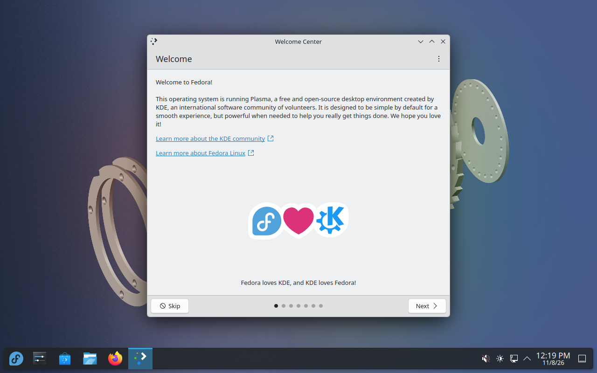
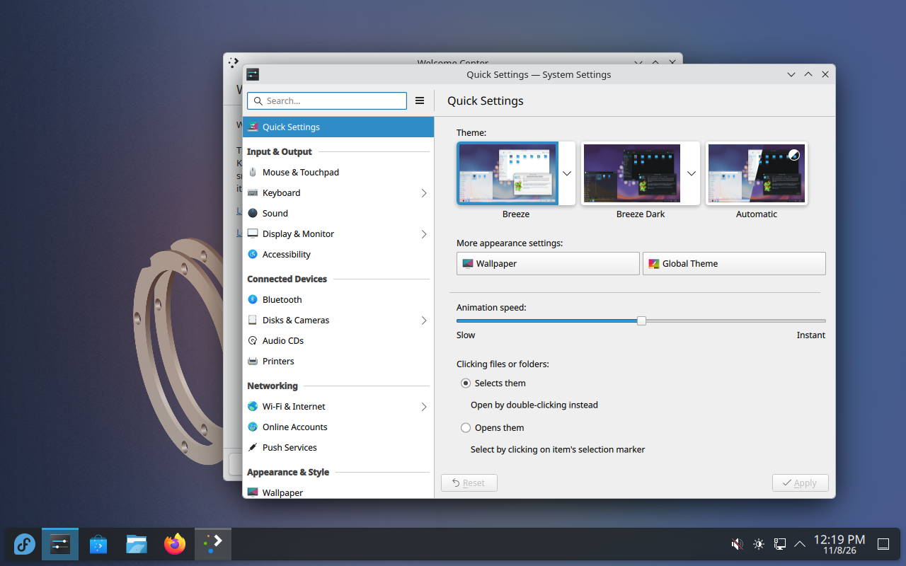

# M1 — Risultati dei test in macchina virtuale

- **Ambito:** prototipo OMNI OS **solo in VM** (QEMU/KVM su runner GitHub Actions `ubuntu-24.04`). Nessuna installazione fisica, nessuna immagine pubblicata.
- **Base:** `quay.io/fedora/fedora-kinoite@sha256:0e0649d7c3bc07cfd42c2daa0a0b81c3291a09721179f6f0355cbb70618925ee` (Fedora Kinoite 45.20261105.0, kernel 7.2.15-300.fc45) — **eccezione A1: non firmata, solo VM**.
- **Workflow:** `.github/workflows/m1-vm.yml`. Tutti i dati qui sotto provengono dai log delle esecuzioni indicate; nulla è stato dichiarato superato senza un'esecuzione reale.

## 1. Esecuzione di riferimento

| Campo | Valore |
|---|---|
| Esecuzione completa superata | [42099981099](https://github.com/andrew14420100/OMNI-OS/actions/runs/42099981099), commit `2bae45f`, 2026-11-05 20:05–20:36 UTC (31 min) |
| Esito | **Tutti i passi P1–P9 e P6b superati** |
| Conferma | [42105279344](https://github.com/andrew14420100/OMNI-OS/actions/runs/42105279344), commit `e927d1a`: di nuovo **tutti i passi P1–P9 superati** (2 esecuzioni complete superate) |
| Esecuzioni precedenti usate per §3 | [42080528120](https://github.com/andrew14420100/OMNI-OS/actions/runs/42080528120) (`96560c1`): P1–P8 superati; P1–P8 superati anche in 42085279880 e 42094583863 (risultati ripetuti in 4 esecuzioni) |
| Runner | 4 CPU, 15 GB RAM, KVM disponibile, 99 GB liberi su `/`, podman 4.9.3, QEMU 8.2.2 |

## 2. Risultati per passo

| Passo | Verifica | Esito | Dati rilevati |
|---|---|---|---|
| P1 | Download della base per digest e confronto | **Superato** | Digest scaricato = digest approvato; tag `45` punta ancora allo stesso manifest amd64; etichette `45.20261105.0`, `containers.bootc=1`, kernel `7.2.15-300.fc45.x86_64` |
| P2 | Build dell'immagine OMNI | **Superato** | `bootc container lint` nella build: 14 controlli superati, 1 saltato |
| P3 | `bootc container lint` esplicito | **Superato** | 14 superati, 1 saltato |
| P4 | Contenuto dell'immagine | **Superato** | `build-info` 0.1.0-m1-dev; Fedora 45, variante kinoite; plasma-workspace 6.8.2, kwin 6.8.2, NetworkManager 1.58.1; gestore di accesso **plasmalogin** (non SDDM) |
| P5 | Disco di prova con `bootc install to-disk --via-loopback` | **Superato** | Disco raw 30 GB (7,1 GB occupati), bootloader GRUB via bootupd, filesystem XFS |
| P6 | Avvio UEFI e controlli nel sistema | **Superato** | SSH dopo 22 s; avvio UEFI; `/run/ostree-booted`; systemd `degraded` **solo** per `mcelog.service` (atteso in VM); `graphical.target` attivo; `plasmalogin` attivo; NetworkManager attivo con IPv4; `bootc status` e `rpm-ostree status` mostrano l'immagine OMNI 0.1.0-m1-dev |
| P7 | Schermata via monitor QMP | **Superato** (cattura) | PNG di 565 KB. **Esaminata a vista il 2026-11-08:** mostra la **procedura di primo avvio di KDE** ("Welcome to Plasma Desktop — Begin Setup", "Powered by Fedora Linux"), **non** una schermata di login né il desktop: sul disco di prova non esisteva alcun utente. Le due esecuzioni superate hanno prodotto la stessa immagine (SHA-256 `273f264c…`). Copia: `img/reale-p7-primo-avvio-run42105279344.png`; estratto della console di avvio: `img/reale-p6-console-avvio-run42105279344.txt` |
| P6b | Avvio con Secure Boot emulato (OVMF, chiavi Microsoft) | **Superato** | Variabile EFI `SecureBoot` = 1 nella VM; kernel 7.2.15 avviato; SSH dopo 27 s |
| P8 bootc | Aggiornamento, rollback, errori | **Superato** | Vedi §3 |
| P8 rpm-ostree | Aggiornamento, rollback, errori | **Superato** | Vedi §3 |
| P9 | Firme con chiavi effimere | **Superato** (42099981099) | Vedi §3.1 |

## 3. P8 — confronto bootc / rpm-ostree

Test identici, ciascuno su una copia **mai avviata** dello stesso disco. N = 0.1.0-m1-dev, N+1 = 0.1.1-m1-dev (stessa base, solo versione diversa), trasferita nella VM come archivio OCI locale.

| Passo | bootc | rpm-ostree |
|---|---|---|
| E1 — archivio corrotto | Rifiutato; deployment invariati | Rifiutato; deployment invariati |
| E2 — aggiornamento preparato, poi spegnimento forzato della VM | Riavvio riuscito su N (aggiornamento non applicato), sistema coerente | Riavvio riuscito su N, sistema coerente |
| U1 — aggiornamento a N+1 e riavvio | Versione 0.1.1-m1-dev | Versione 0.1.1-m1-dev |
| R1 — rollback e riavvio | Versione 0.1.0-m1-dev, gestore di accesso attivo | Versione 0.1.0-m1-dev, gestore di accesso attivo |
| Durata totale del test | 253 s | 211 s |
| Preparazione E2 | 74 s | 55 s |
| Comando di aggiornamento | `bootc switch --transport oci-archive …` | `rpm-ostree rebase ostree-unverified-image:oci-archive:…` |
| Comando di rollback | `bootc rollback` | `rpm-ostree rollback` |

**Osservazioni (non ancora una raccomandazione definitiva):**

- Nei casi provati i due gestori si comportano **allo stesso modo**: nessuna differenza funzionale osservata.
- rpm-ostree è risultato un po' più rapido in questa singola esecuzione (211 s contro 253 s), ma una sola misura non basta per concludere; i tempi dipendono anche dal runner.
- Entrambi vedono lo stesso deployment: dopo l'installazione `rpm-ostree status` mostra l'immagine come `ostree-unverified-registry:localhost/omni-os:m1-ci`, coerente con `bootc status`.
- Con le firme (P9) entrambi rifiutano immagini non firmate o firmate con chiavi sconosciute e accettano quelle firmate correttamente; cambia il modo di richiedere la verifica (vedi §3.1).
- Non provati: pacchetti stratificati sul client, aggiornamenti automatici con timer, persistenza dell'obbligo di firma negli aggiornamenti successivi.

### Raccomandazione provvisoria (richiesta dal proprietario, non è una decisione)

**rpm-ostree come gestore primario per i passi successivi, mantenendo la compatibilità con bootc**, per questi motivi osservati:

1. nessuna differenza funzionale nei test di aggiornamento, rollback ed errori;
2. con rpm-ostree l'obbligo di firma è scritto nel riferimento dell'immagine (`ostree-image-signed:`), quindi non dipende dal ricordarsi un'opzione a ogni comando; con bootc va richiesto esplicitamente e la sua persistenza non è ancora verificata;
3. rpm-ostree espone l'API D-Bus prevista per OMNI Update Center (ADR-0003).

Prima di una decisione definitiva propongo tre test aggiuntivi: (T1) `bootc upgrade` dopo uno switch con `--enforce-container-sigpolicy`, per verificare se la firma resta obbligatoria; (T2) aggiornamento automatico con i timer dei due gestori; (T3) ripetizione delle misure di tempo su più esecuzioni.

### 3.1 P9 — verifica delle firme (esecuzione 42099981099)

Chiavi cosign **effimere**, generate e distrutte nel job; firma senza registro di trasparenza pubblico (`--tlog-upload=false`); registro OCI locale in ascolto solo su `127.0.0.1:5000` del runner, raggiunto dalla VM come `10.0.2.2:5000`. Nella VM: policy `default: reject` e `sigstoreSigned` con la chiave pubblica di prova per `10.0.2.2:5000/omni-os`.

| Passo | Esito |
|---|---|
| Registro locale attivo (solo loopback) | OK |
| Immagine firmata (0.1.1) e non firmata (0.1.2) caricate, digest diversi | OK |
| Firma con chiave effimera, identità `10.0.2.2:5000/omni-os` | OK |
| Verifica sull'host: firmata valida / non firmata rifiutata | OK / OK |
| S1 bootc — immagine **non firmata** | **Rifiutata** ("A signature was required, but no signature exists") |
| S2 rpm-ostree — immagine **non firmata** | **Rifiutata** |
| S3 bootc — firma con **chiave non riconosciuta** | **Rifiutata** ("invalid signature when validating ASN.1 encoded signature") |
| S4 rpm-ostree — firma con **chiave non riconosciuta** | **Rifiutata** |
| S5 rpm-ostree — immagine firmata con la chiave corretta | **Accettata** (aggiornamento preparato) |
| S6 bootc — immagine firmata con la chiave corretta | **Accettata**, riavvio, sistema avviato su **0.1.1-m1-dev** |
| Chiavi effimere distrutte | OK |

Differenza rilevata fra i gestori: con **bootc** la verifica della policy va richiesta esplicitamente (`bootc switch --enforce-container-sigpolicy`); con **rpm-ostree** è espressa nel riferimento stesso (`ostree-image-signed:docker://…`). **Non è stato verificato** se, dopo lo switch, i successivi `bootc upgrade` continuino a imporre la verifica.

## 4. Problemi incontrati e correzioni (in ordine)

| # | Esecuzione | Problema | Causa | Correzione |
|---|---|---|---|---|
| 1 | 42074869664 | P4 fallito: `sddm` non installato | **Ipotesi errata del test**: Kinoite 45 usa `plasmalogin` | Il test legge `display-manager.service` invece di presumere SDDM |
| 2 | 42076095926 | P5 fallito: `bootc install` "no such object" | `bootc install` esegue il podman dell'host con la configurazione predefinita: lo storage personalizzato usato nel workflow non era visibile | Storage predefinito `/var/lib/containers` (invocazione documentata di bootc) |
| 3 | 42077152935 | P2 fallito: immagine "non trovata" per nome subito dopo la build | **Non determinata**. Nell'esecuzione successiva, con passi diagnostici e ri-etichettatura di riserva, P2 è riuscito | P2 registra l'ID con `--iidfile` e verifica nome e ID; resta da capire la causa |
| 4 | 42078680056 | P6 fallito: systemd in `starting` | Il test controllava troppo presto | Attesa con `systemctl is-system-running --wait`; `degraded` accettato solo per guasti attesi in VM elencati e motivati |
| 5 | 42080528120 | P9 fallito: registro locale non attivo | Da determinare (output del servizio non registrato) | Diagnostica aggiunta; esecuzione ripetuta |
| 6 | 42085279880 | P9 fallito di nuovo (P1–P8 di nuovo tutti superati: risultati ripetibili) | Il pacchetto Ubuntu `docker-registry` abilita per default l'autenticazione `htpasswd`: ogni richiesta riceveva `401`. Il servizio era attivo e in ascolto **solo su 127.0.0.1:5000** (verificato con `ss`) | Configurazione minima scritta per intero: nessuna autenticazione, solo loopback, dati in cartella temporanea |
| 7 | 42094016024 | P1 fallito: download interrotto | Guasto di rete esterno: il CDN di quay.io ha chiuso la connessione durante il download di un blob (`unexpected EOF`). Non legato al codice OMNI | P1 ritenta fino a 3 volte; il controllo del digest resta obbligatorio |
| 8 | 42094583863 | P9: S1–S4 superati (rifiuto di immagini non firmate e di chiavi sconosciute con entrambi i gestori), S5–S6 falliti: immagine firmata correttamente rifiutata con `Signature for identity "127.0.0.1:5000/omni-os" is not accepted` | **Errore del test**: con `remapIdentity` il nome rimappato mantiene il tag `:signed`, mentre la firma cosign contiene solo il repository; la corrispondenza esatta fallisce | Firma con `--sign-container-identity 10.0.2.2:5000/omni-os` e policy `matchRepository` |
| 9 | 42099981099 | — | — | **Tutti i passi superati** |

## 5. Cosa NON è stato verificato

- Contenuto visivo della schermata di accesso (P7 prova solo la cattura).
- Accesso utente a una sessione Plasma (nessun utente grafico creato sul disco di prova).
- Driver NVIDIA (assenti in VM, AC-M1-10), hardware reale, HDR/VRR.
- Aggiornamenti da registry remoto e pacchetti stratificati sul client.
- Ripetibilità statistica dei tempi (P8 eseguito con successo in 4 esecuzioni, ma i tempi riportati sono di una sola).
- Causa dell'anomalia di P2 (immagine non trovata per nome in una esecuzione): non riprodotta né spiegata.
- Persistenza dell'obbligo di firma con bootc dopo lo switch (T1).

## 6. Completamento M1 — esecuzione 42183152118 (2026-11-06): interrotta, base non più disponibile

Prima esecuzione del workflow `m1-completamento` (commit `623f27e`): **nessun test eseguito**. Tutti i 10 job si sono fermati nella preparazione:

| Causa | Job colpiti | Esito |
|---|---|---|
| **Digest approvato rimosso da quay.io**: `quay.io/fedora/fedora-kinoite@sha256:0e0649d7…` risponde `manifest unknown` (HTTP 404, verificato anche con l'API del registro). Il tag `45` è stato spostato il 2026-11-06 01:16 UTC su `45.20261106.0` (amd64 `sha256:5bd1be0ef530421cb187759ed09dc5eb33118fe903d6d3d97c85637adf78d933`). La cronologia del tag mostra uno spostamento circa ogni 24 ore e i manifest precedenti non restano scaricabili | Tutti | **Bloccante**: rischio R-28 verificatosi |
| `/dev/kvm` non ancora accessibile al momento del controllo: la regola udev si applica in modo asincrono | 4 job con VM, prima di arrivare al download | Corretto in `fc535fd` (`udevadm settle` + attesa); non ancora verificato in CI |

Anche l'esecuzione di regressione `m1-vm` sullo stesso commit è stata annullata: avrebbe fallito al download della base.

Conseguenze:

- I risultati di P1–P9 restano validi **per la base `0e0649d7…`**, con cui sono stati ottenuti (esecuzioni 42099981099 e 42105279344), ma quella base non è più riproducibile.
- AC-M1-07 (riproducibilità) **non può essere soddisfatto nel tempo** con una base A1: una build è ripetibile solo finché il manifest esiste, cioè circa un giorno.
- Disponibilità verificata delle alternative (2026-11-06): il commit ostree ufficiale firmato di ieri (`83719586…`, 45.20261105.0) è ancora presente con la firma nel repository Fedora (A3); le immagini firmate del SIG (A2) conservano i tag datati dal 45.20261010.0 al 45.20261106.0 (circa 4 settimane).

## 7. P1–P9 sulla base B3 — esecuzione 42473555885 (2026-11-08): SUPERATI

Commit `4dbfab9`, base B3 caricata dalla cache e verificata: digest `sha256:34ee4c0b…` uguale a quello fissato e sha256 di manifest, configurazione e 65 layer controllati. Durata: 31 minuti.

| Passo | Esito | Evidenze |
|---|---|---|
| P1 base | Superato | Digest fissato e blob verificati; commit `5a4ff74f…` |
| P2 build, P3 `bootc container lint`, P4 contenuto | Superati | Fedora 45 Kinoite, kernel 7.2.15-300.fc45, plasma-workspace 6.8.2, kwin 6.8.2, plasmalogin (plasma-login-manager 6.8.2) |
| P5 disco (`bootc install to-disk`) | Superato | — |
| P6 avvio UEFI e controlli | Superato | UEFI, ostree, `graphical.target`, gestore di accesso attivo, rete; unità fallite solo `mcelog` (attesa in VM). **Permessi sensibili di `/etc` uguali al commit verificato** (`grub.d` 700, `audit` 750, `nftables` 700, `selinux/targeted/active` 700, gruppo 7 di `cups`, sia in `/usr/etc` sia in `/etc`) |
| P6b Secure Boot emulato | Superato | Kernel 7.2.15 avviato con Secure Boot attivo (variabile EFI) |
| P7 schermata | Superato | Configurazione iniziale di KDE. La schermata è **identica byte per byte** a quella ottenuta con la base A1 (sha256 `273f264c…`): nessuna regressione visibile al primo avvio |
| P8 bootc | Superato | E1 archivio corrotto rifiutato, deployment invariati; E2 spegnimento forzato durante l'aggiornamento con sistema coerente; U1 da 0.1.0 a 0.1.1; R1 rollback a 0.1.0 con gestore di accesso attivo |
| P8 rpm-ostree | Superato | Stessi passi E1, E2, U1, R1 |
| P9 firme (chiavi effimere) | Superato | S1–S4: immagini non firmate o con chiave sconosciuta rifiutate da entrambi i gestori; S5–S6: immagine firmata accettata, avvio sulla 0.1.1 |

**Confronto con A1 (run 42105279344):** stessi passi superati e stessa schermata P7. In più, solo con B3, il controllo dei permessi di `/etc`. Nessuna regressione rilevata.

## 8. Gruppo A sulla base B3 (2026-11-08)

### AC-M1-03 — accesso reale e sessione Plasma Wayland: SUPERATO (run 42478499478)

Prima esecuzione (run 42476148840): accesso riuscito, ma due controlli falliti per un errore del test, che presumeva il socket `wayland-0`. KWin in Plasma 6.8 usa `wayland-1`. Ora il test legge `WAYLAND_DISPLAY` dall'ambiente di plasmashell (commit `939c3ae`) e il test è stato ripetuto da solo (gruppo `A-desktop`).

Esito della run 42478499478, 20 controlli su 20 OK:
- utente temporaneo con password casuale mascherata;
- accesso digitato sulla schermata plasmalogin (QMP) al primo tentativo;
- sessione `wayland`, classe `user`, attiva, locale (servizio PAM `plasmalogin`, desktop KDE);
- `kwin_wayland` e `plasmashell` in esecuzione e raggiungibili su D-Bus; socket `/run/user/1000/wayland-1`;
- Impostazioni di sistema aperte nella sessione e ancora in esecuzione dopo 20 s;
- stessi PID di plasmashell e KWin prima e dopo l'uso, nessun core dump;
- utente e password eliminati al termine.

Schermate reali catturate dallo schermo della VM con QMP:

| Schermata di accesso | Desktop dopo l'accesso | Applicazione aperta |
|---|---|---|
|  |  |  |

È il desktop **Fedora Kinoite/Plasma** dell'immagine M1, non l'interfaccia OMNI.

### AC-M1-05 — R2 e R3: SUPERATI (run 42476148840)

Stessa sequenza, superata con **bootc** e con **rpm-ostree**:
- R2.1–R2.3: aggiornamenti 0.1.0 → 0.1.1 → 0.1.2, con 0.1.0 fissato (`ostree admin pin`), ancora presente dopo due aggiornamenti.
- R2.4 controllo: la 0.1.1 non fissata viene eliminata, la 0.1.0 fissata resta.
- R2.5: la 0.1.0 fissata impostata come predefinita (`set-default`) si avvia.
- R3.1–R3.2: aggiornamento dal registro temporaneo (solo loopback) e ritorno alla 0.1.1 per digest.

Dopo ogni riavvio il gestore di accesso risulta attivo.

## 9. Gruppo B sulla base B3 (2026-11-08)

### T1/T2 — firma negli aggiornamenti successivi e aggiornamenti automatici

| Gestore | Run | Esito |
|---|---|---|
| rpm-ostree | 42480227200 | **Superato**: T1.1 passaggio verificato a 0.1.1; T1.2 immagine non firmata rifiutata; T1.4 immagine firmata accettata (0.1.2); T2.1 aggiornamento automatico non firmato rifiutato, sistema invariato; T2.2 registro irraggiungibile gestito; T2.3 aggiornamento automatico firmato preparato (politica `stage`) e avviato (0.1.3) |
| bootc | 42480227200 | **Fallito**: `bootc switch --enforce-container-sigpolicy` ha preparato la 0.1.1 ("Queued for next boot"), ma allo spegnimento `ostree-finalize-staged.service` è terminato con esito `failed` (console seriale) e il sistema è ripartito sulla 0.1.0. I passi successivi sono falliti di conseguenza |
| bootc | 42493088051 | **Superato**: stessi passi di rpm-ostree; in T2.3 `bootc-fetch-apply-updates.service` ha applicato l'aggiornamento firmato con riavvio automatico (0.1.3) |

**Problema aperto (R-34, intermittente):** 1 fallimento della finalizzazione con bootc su 2 esecuzioni di T1/T2. Altre esecuzioni con lo stesso meccanismo sono riuscite: P9 S6 (run 42473555885), P8 bootc, R2/R3 bootc. La causa non è determinata, perché il journal dell'avvio precedente non veniva ancora raccolto. Ora `check_booted` lo raccoglie automaticamente (commit `7d3e960`). In ogni caso il sistema è rimasto **avviabile e coerente** sulla versione precedente: è un mancato aggiornamento, non una corruzione.

### T3 — tempi (run 42480227200), 4 ripetizioni di aggiornamento e rollback per gestore: SUPERATO

| Fase (s) | bootc media ± dev. std (min–max) | rpm-ostree media ± dev. std (min–max) |
|---|---|---|
| preparazione dell'aggiornamento | 47,9 ± 11,1 (38,6–61,1) | 47,0 ± 11,8 (36,7–58,1) |
| riavvio dopo l'aggiornamento | 32,5 ± 7,0 (22–36) | 37,0 ± 0,8 (36–38) |
| comando di rollback | 4,8 ± 1,6 (3,6–7,1) | 6,8 ± 0,9 (5,5–7,5) |
| riavvio dopo il rollback | 22,8 ± 0,5 (22–23) | 26,0 ± 6,7 (22–36) |

Con 4 ripetizioni su runner condivisi le differenze tra i gestori stanno dentro la variabilità misurata: **nessuna differenza di prestazioni significativa**. La scelta del gestore resta una decisione del proprietario (ADR-0003). Questi dati non la prendono.

## 10. Gruppo C sulla base B3 (2026-11-08)

### AC-M1-08 — SBOM (run 42495967226): SUPERATO
SPDX 2.3 e CycloneDX 1.7 generati con syft 1.55.0 (checksum fissato): 1746 pacchetti RPM in entrambi, 0 installati e mancanti, 0 in eccesso rispetto a `rpm -qa`; 7569 componenti in totale.

### AC-M1-07 — riproducibilità: SUPERATO

| Esecuzione | Build predefinita, A contro B | Build `--timestamp 0`, A contro B |
|---|---|---|
| 42495967226 | fallita prima del confronto (`cd` senza sudo nel punto di montaggio, corretto in `a21c52d`) | — |
| 42498047150 | funzionalmente identiche; 2 layer su 67 diversi | **non valida**: stesso ID della build predefinita (cache di podman); corretta in `4afa83e` con `--no-cache` e controllo degli ID |
| 42500407639 | funzionalmente identiche; 1 layer su 67 diverso; ID diversi | **identità binaria**: ID `1b7dff69…` uguale, 67 layer su 67 identici, data di creazione 1970-01-01 |

In tutti i confronti validi: 1746 pacchetti (NEVRA) identici, 472 244 voci del filesystem e 402 151 file con contenuto e metadati identici. Le date di modifica diverse nella vista montata (circa 12 400) non sono contenute nei layer, che sono identici per digest.
