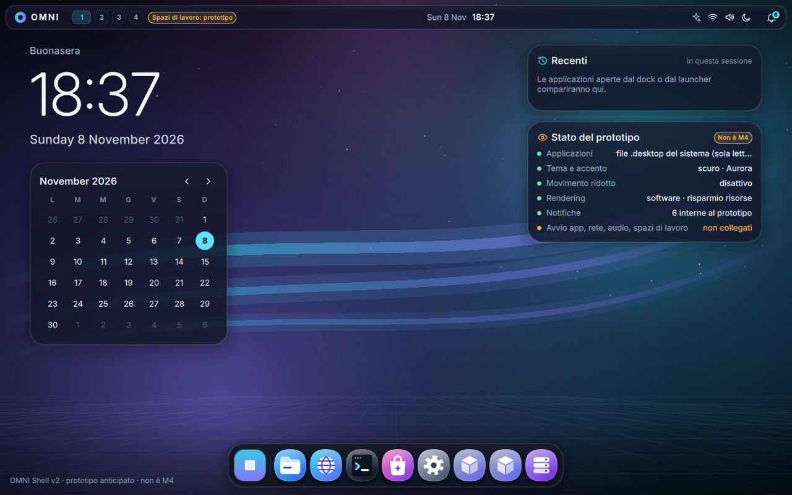
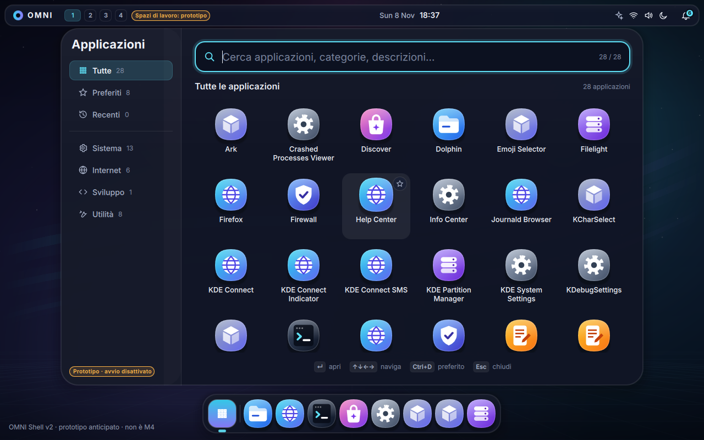
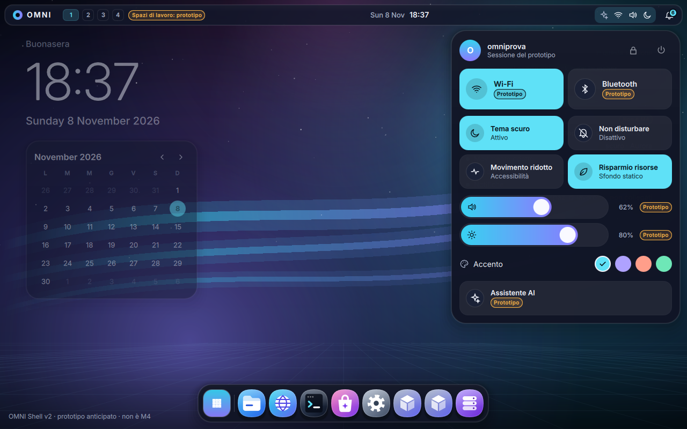
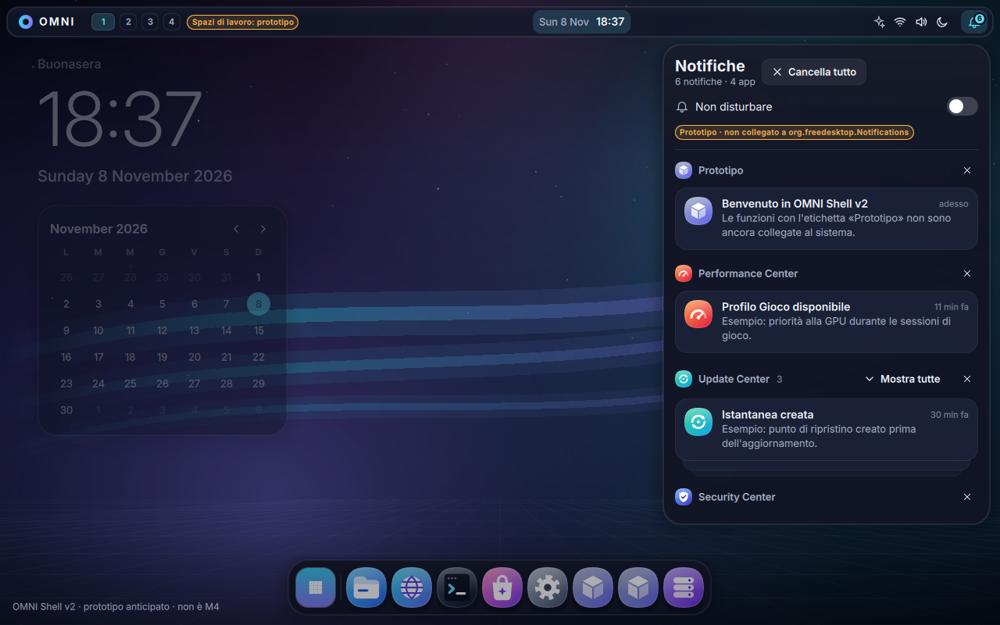
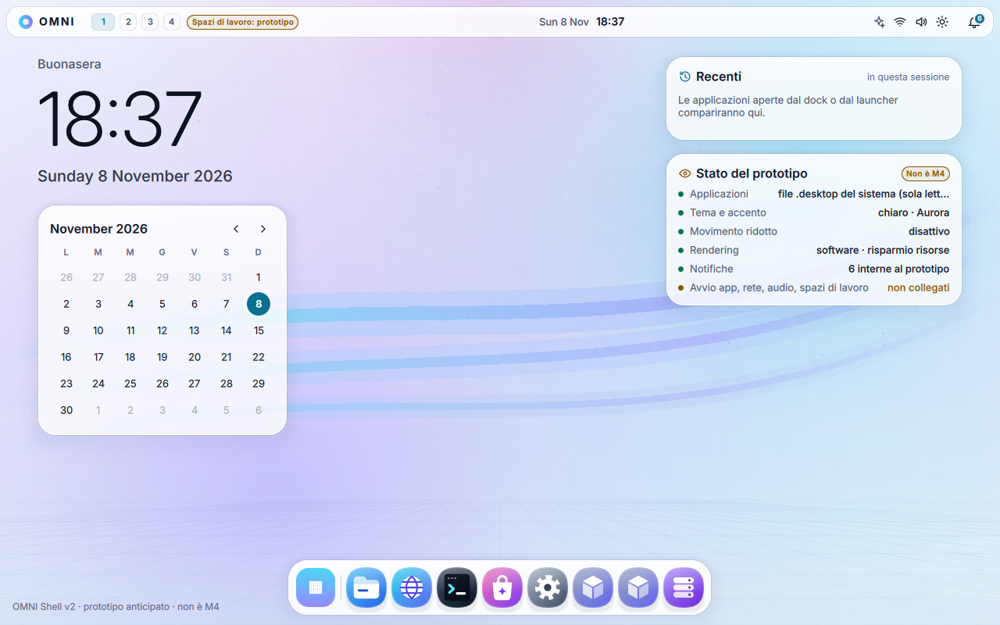
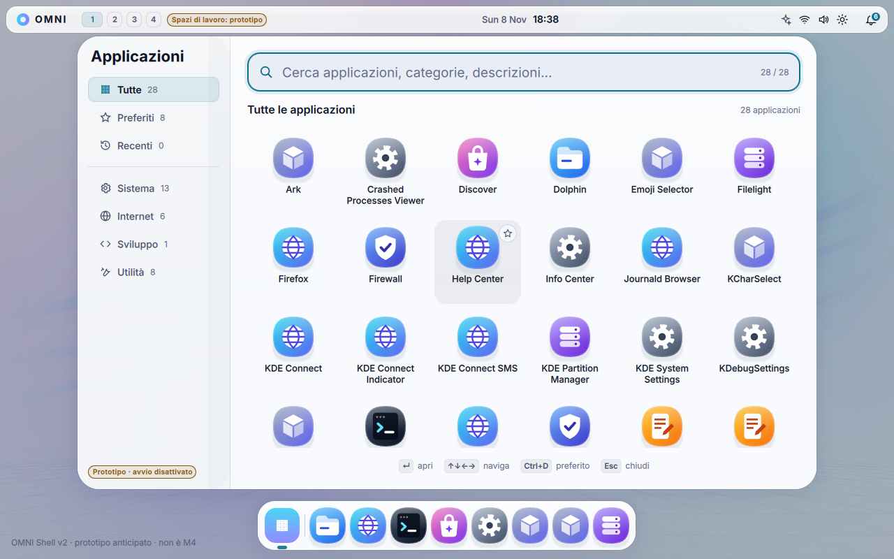

# Integrazione sperimentale di OMNI Shell V2 in una VM OMNI OS

- **Stato:** prova sperimentale, 2026-11-08. **Non è M4.** Branch `claude/omni-shell-vm-integrazione`, PR #4 in bozza, nessun merge.
- **Condizione rispettata:** iniziata dopo il superamento in VM dei 10 criteri M1 (`../10-rapporti/rapporto-M1.md` §16).
- **Cosa NON cambia:** Plasma, KWin e il gestore di accesso (plasmalogin) non vengono sostituiti. L'immagine OMNI e il suo disco non vengono modificati. OMNI Shell gira come **normale applicazione dell'utente**, installata nella sua home.

## 1. Procedura (workflow `omni-shell-vm`)

1. **Base B3** caricata e verificata (digest fissato, blob), oppure derivata di nuovo con la procedura completa se manca nella cache del branch.
2. Immagine OMNI e disco di prova costruiti come in M1.
3. **Compilazione** in `quay.io/fedora/fedora:45` con **la stessa versione di Qt dell'immagine OMNI** (letta dall'immagine). Esecuzione dei test: 11 C++ e i test QML.
4. Avvio della VM e **accesso reale** a Plasma Wayland con un utente temporaneo, tramite la schermata plasmalogin.
5. Copia di OMNI Shell nella home dell'utente: proprietà dell'utente, nessun setuid, nessun file di sistema.
6. Avvio a schermo intero come **client Wayland** della sessione (`WAYLAND_DISPLAY` della sessione, `QT_QPA_PLATFORM=wayland`).
7. Misura della posizione reale degli elementi nella VM (`--dump-geometry`).
8. Sei scene nei temi scuro e chiaro, con schermate dello **schermo della VM** (QMP `screendump`).
9. **Interazioni reali** con tavoletta USB e tastiera virtuali di QEMU: dock, anteprima di apertura, launcher con ricerca e categorie, impostazioni rapide (tema e accento), notifiche (espansione e trascinamento). Lo schermo viene registrato e convertito in video.
10. Controlli di regressione e pulizia: chiusura dell'app, PID di plasmashell e KWin, stato della sessione, core dump, file fuori dalla home, eliminazione dell'utente.

## 2. Esiti

| Run | Esito | Note |
|---|---|---|
| 42500867550 | Fallita prima della prova | La cache della base B3 è legata al branch M1. Aggiunta la derivazione verificata sul branch |
| 42501784476 | Fallita prima della prova | Regola di tolleranza della vista container troppo stretta (6 cartelle in `usr/`). Corretta anche in M1 (`994ff7e`) |
| 42505659202 | Fallita alla compilazione | Base B3 derivata sul branch con lo **stesso digest**. L'immagine Kinoite non contiene `dnf`: compilazione spostata in `fedora:45` |
| **42509871593** | **Prova eseguita: 21 controlli OK, 1 FAIL** | Il FAIL riguarda il registro della piattaforma, vuoto perché Qt scriveva nel journal (corretto con `QT_FORCE_STDERR_LOGGING=1`) |

### Run 42509871593 in dettaglio

- **Qt:** stessa versione dell'immagine sia in compilazione sia in esecuzione: qt6-qtbase 6.11.2-3.fc45, qt6-qtdeclarative 6.11.2-2.fc45. Test: 2/2 suite superate.
- **Accesso e sessione:** accesso reale a Plasma, sessione Wayland 13, display `wayland-1`.
- **Funzionamento:** tutte e 6 le scene in esecuzione. Interazioni reali senza crash. **0 avvisi QML.**
- **Rendering:** nella VM risulta **software**, quindi il risparmio risorse è attivo, come indicato nella scheda di stato.
- **Launcher:** elenca le **28 applicazioni realmente installate** in Fedora Kinoite, lette in sola lettura dai file `.desktop`.
- **Nessuna regressione:**
  - PID di plasmashell e kwin_wayland invariati (3349, 3285);
  - sessione ancora attiva;
  - nessun core dump;
  - nessun file di OMNI Shell in `/usr`, `/etc` o `/opt`;
  - utente eliminato.

| Desktop (scuro) | Launcher (scuro) | Impostazioni rapide |
|---|---|---|
|  |  |  |
| **Notifiche** | **Desktop (chiaro)** | **Launcher (chiaro)** |
|  |  |  |

Sono schermate **reali dello schermo della VM**, non immagini generate. Il video delle interazioni (circa 49 s) è nell'artifact `omni-shell-vm` della run.

## 3. Cosa è reale e cosa è prototipo

| Reale (funzione effettiva del sistema) | Prototipo (dichiarato nell'interfaccia) |
|---|---|
| OMNI OS avviato in VM, accesso tramite plasmalogin | Avvio delle applicazioni: solo animazione dichiarata, nessun processo avviato |
| Sessione KDE Plasma Wayland, KWin | Wi-Fi, Bluetooth, volume, luminosità |
| OMNI Shell come client Wayland con il Qt di Fedora 45 | Spazi di lavoro (non collegati a KWin) |
| Elenco delle app installate (file `.desktop`, sola lettura) | Notifiche (interne al prototipo, non `org.freedesktop.Notifications`) |
| Tema, accento, movimento ridotto, risparmio risorse | Assistente AI, blocco e spegnimento |

## 4. Miglioramenti nati dalla prova nella VM

- **Risparmio risorse automatico** con rendering software (llvmpipe): commit `271d999`.
- **6 nuove icone e regole** per le app KDE viste nella VM: Ark, Help Center, Journald Browser, KDE Connect, Emoji Selector, KCharSelect, Crashed Processes Viewer, KDebugSettings. **Date in italiano** come i testi. Commit `340e9b5`.
