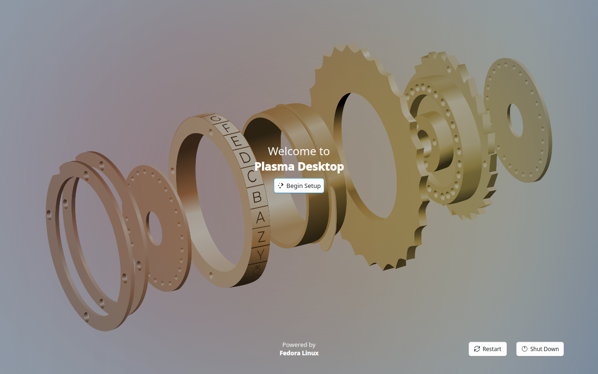
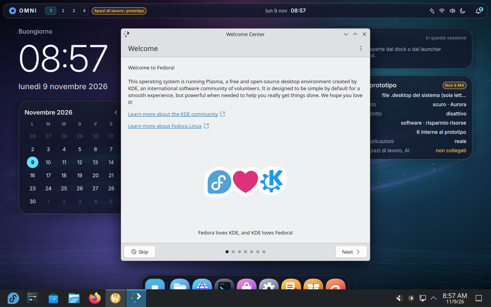
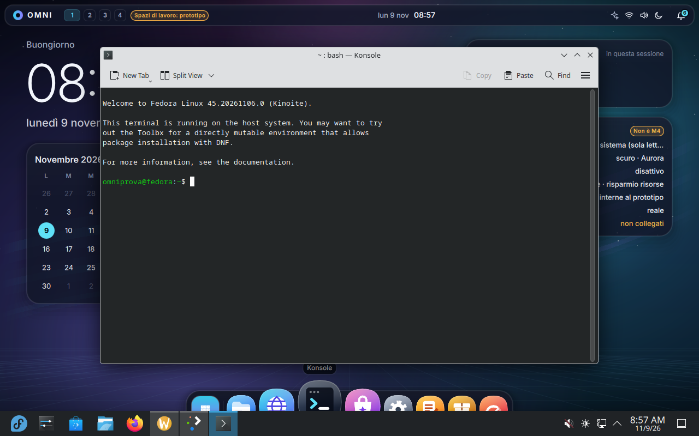
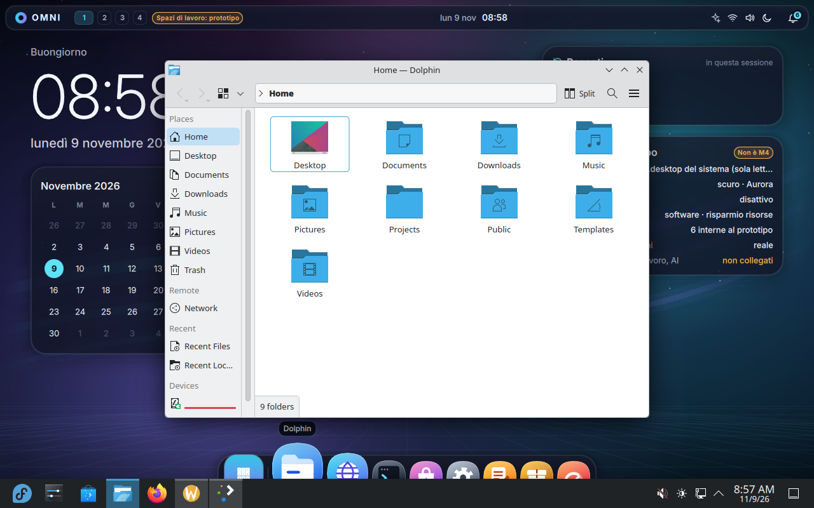
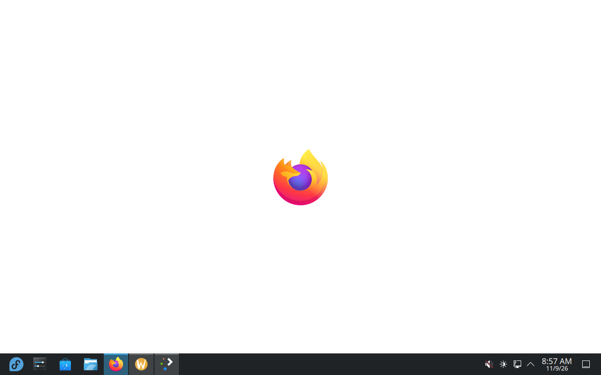
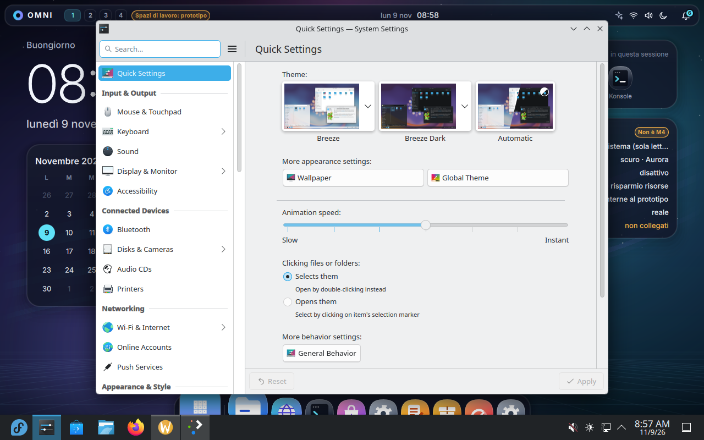
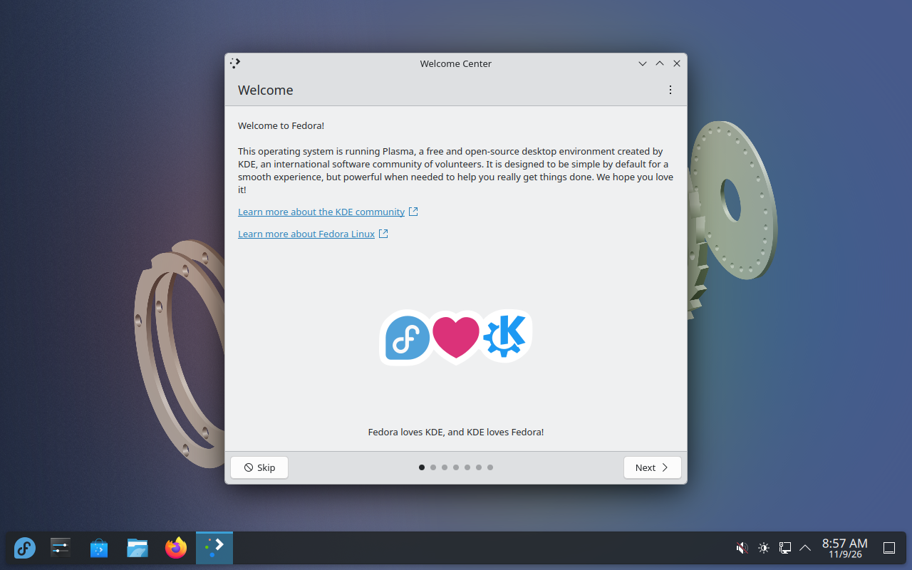
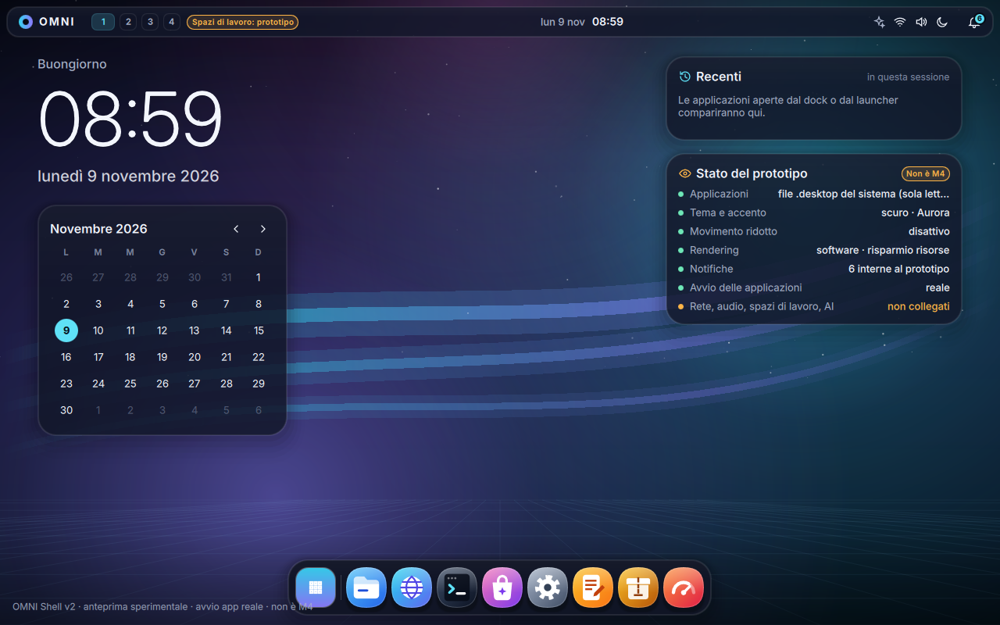

# 13 — VM personale (anteprima sperimentale)

Obiettivo: un disco di OMNI OS da provare personalmente in una macchina virtuale su
Windows 11 (VirtualBox o VMware), con OMNI Shell V2 nella sessione Plasma. Non è una
milestone (non M2/M3/M4), non è una release, non sostituisce Plasma, KWin o il gestore
di accesso. Le 55 decisioni approvate non cambiano.

## Come è costruito

| Passo | Dove |
|---|---|
| Base B3 verificata (GPG Fedora, digest fissato, prove negative) | `tests/vm/base_b3.sh`, `image/base.lock` |
| Immagine OMNI M1 | `image/Containerfile` (come in M1) |
| OMNI Shell compilata con le **stesse** Qt dell'immagine, test inclusi | `tests/vm/build_shell_bundle.sh` |
| Immagine personale = M1 + OMNI Shell in `/usr/lib/omni-shell`, `/usr/bin/omni-shell`, voce di menu, avvio automatico | `image/personale/` |
| Disco personale senza chiavi, senza utenti, senza console seriale | `tests/vm/make_disk.sh … none` |
| VMDK compresso + SHA256SUMS + inventario del software + LEGGIMI | `.github/workflows/omni-vm-personale.yml` |

`--real-launch` è attivo solo nell'immagine personale e solo per i file `.desktop`
effettivamente elencati dal modello delle applicazioni (nessuna shell, nessun comando
arbitrario): `gio launch <file.desktop>`, ripiego `kstart --application <id>`.

## Controlli

1. **Prova reale** (`tests/vm/personale_test.sh`) su un disco di test costruito dalla
   *stessa* immagine con la sola aggiunta della chiave SSH effimera di CI: accesso grafico
   di un utente temporaneo, avvio automatico di OMNI Shell come utente (non root), clic
   reali (QMP) sul dock per Konsole, Dolphin e browser, ricerca "settings" nel launcher,
   uscita da OMNI Shell con Plasma intatto, riapertura dal menu, assenza di core dump.
2. **Sicurezza del disco consegnato** (`tests/vm/personale_sicurezza.sh`), montato in sola
   lettura: nessun `authorized_keys`, chiave di test assente, nessun utente ≥ 1000, root
   bloccato, sshd non abilitato, voci di avvio senza console seriale né sshd, eseguibile
   755 root senza setuid.
3. **Primo avvio** di una copia del disco consegnato: schermata della configurazione
   iniziale (creazione dell'account).
4. **Inventario del software** (RPM e impronte dei file di OMNI Shell). syft fa arrestare
   il runner su questa immagine; lo SBOM SPDX/CycloneDX della base M1 resta quello
   verificato (AC-M1-08, run 42495967226).

Il disco di test e il disco consegnato derivano dalla stessa immagine; differiscono solo
per le opzioni di `bootc install` (chiave e console), verificate dal punto 2.

Procedura per l'utente: [LEGGIMI.md](LEGGIMI.md).

## Risultati (run 42588200637, commit ac5fede)

Artifact `OMNI-OS-0.2.0-VM-personale` (3,3 GB): VMDK streamOptimized
`420ff477d545ab652cfeeb2fbe5c1d36f83214d271f5b2064196773fb7a5b28f`, più SHA256SUMS,
LEGGIMI, controlli di sicurezza e inventario (1746 pacchetti RPM).

| Controllo | Esito |
|---|---|
| Prova reale (accesso, avvio automatico, Konsole, Dolphin, Firefox, Impostazioni, uscita, riapertura, nessun core dump) | 20/20 OK |
| Sicurezza del disco consegnato (chiavi, utenti, root bloccato, sshd, argomenti del kernel, permessi) | 8/8 OK |
| Primo avvio del disco consegnato: *Welcome to Plasma Desktop → Begin Setup* | OK |
| Aggiornamenti automatici (rpm-ostreed-automatic, bootc-fetch-apply-updates) | non abilitati |

Il deployment punta a `localhost/omni-os:personale`, che fuori dalla CI non esiste:
`bootc upgrade` / `rpm-ostree upgrade` non trovano aggiornamenti. È voluto (nessun registry,
nessuna pubblicazione).

Problemi trovati e corretti durante il lavoro: caratteri in formato .ttf (non .otf);
binding di Main.qml che lasciava l'interfaccia in modalità simulata; `Qt.quit()` non
collegato con QQuickView; comando SSH bloccato dalla riapertura; controlli di sicurezza
che cercavano nella cartella `backing` di composefs; arresto del runner durante `syft scan`
(sostituito dall'inventario).

| | |
|---|---|
|  |  |
|  |  |
|  |  |
|  |  |
