# 14 — Desktop OMNI reale (anteprima 0.3.0, sperimentale)

Obiettivo: OMNI OS usabile ogni giorno in una macchina virtuale, con queste caratteristiche:
- **una sola interfaccia**: un solo Start, una sola barra e nessun pannello duplicato;
- **funzioni reali** collegate ai servizi di Fedora e KDE;
- prestazioni **misurate**, prima e dopo.

Nessuna funzione di intelligenza artificiale in questa fase.

Non è una milestone formale (non M2, M3 o M4) e non è una release. Le 55 decisioni approvate
non cambiano: la base resta Fedora Kinoite atomica con KDE Plasma e KWin su Wayland, e OMNI
Shell resta scritta in Qt/QML.

## 1. Problemi riportati dall'utente sulla 0.2.0 (VirtualBox, 4K a scala 200%)

| # | Problema | Causa | Correzione |
|---|---|---|---|
| 1 | Launcher di OMNI e menu di Plasma visibili insieme; barre e dock di due interfacce | OMNI Shell 0.2 era una finestra a schermo intero avviata *dentro* la sessione Plasma | Sessione "OMNI OS": il pannello di Plasma non parte; OMNI Shell disegna sfondo, barra e pannelli come superfici del desktop (layer-shell) |
| 2 | Sistema lento (avvio, accesso, app, menu, passaggio del mouse) | vedi §4: misure e cause | §4 |
| 3 | Funzioni simulate (rete, audio, Bluetooth, notifiche, schermo, energia) | il prototipo non era collegato ai servizi | collegate ai servizi reali (§3) |
| 4 | Spegnimento non riuscito | nella 0.2 i pulsanti energia di OMNI erano simulati | `org.kde.Shutdown` (ksmserver: chiude le app, che possono salvare) con ripiego su systemd-logind; provato in VM (§5) |

## 2. Architettura

```
plasmalogin ── sessione "OMNI OS" (/usr/share/wayland-sessions/plasma.desktop, la voce predefinita del gestore di accesso)
                 └─ /usr/libexec/omni-os/omni-session → startplasma-wayland
                      ├─ KWin (finestre, effetti, Alt+Tab, desktop virtuali)       [Plasma]
                      ├─ ksmserver, kded, powerdevil, polkit, portali, kglobalaccel  [Plasma]
                      ├─ plasma-plasmashell.service  → SALTATO (ExecCondition)
                      └─ omni-shell.service → OMNI Shell --session
                           sfondo (layer background) · barra (layer top, zona esclusiva 48 px)
                           pannelli Start/rapide/notifiche (layer top) · fumetti (layer overlay)
            ── "OMNI OS – modalità sicura (desktop Plasma)" → Plasma originale, senza OMNI Shell
```

- **Scelta della sessione**: `omni-session` scrive un marcatore con l'id della sessione di
  login. Le condizioni delle due unità (`omni-session-check omni|plasma`) lo confrontano
  con `XDG_SESSION_ID`. Il marcatore viene rimosso all'uscita, quindi una sessione Plasma
  successiva non eredita mai la scelta.
- **Recupero**: `Restart=on-failure`. Dopo 4 arresti in 120 s, `OnFailure` avvia
  `omni-recupero`, che fa partire il desktop Plasma nella stessa sessione: l'utente non
  resta mai senza interfaccia.
- **Tasto Meta**: KWin chiama `org.kde.plasmashell /PlasmaShell activateLauncherMenu`. Nella
  sessione OMNI quel nome è di OMNI Shell (Plasma non è in esecuzione), quindi il tasto apre
  Start. Il nome non viene mai sottratto a Plasma.
- **Avvio delle app**: `gio launch` del file `.desktop`, con ripiego `kstart`. Solo voci
  lette dal sistema, mai comandi arbitrari.

## 3. Funzioni

| Funzione | Servizio reale | Stato in VirtualBox/QEMU |
|---|---|---|
| Barra: app fissate e finestre aperte, attiva/riduci, nuova finestra, chiudi, gruppi | TasksModel di plasma-workspace (protocollo KWin) | reale |
| Desktop virtuali, Visualizzazione attività, Mostra desktop | KWin: VirtualDesktopManager, scorciatoie Overview / Show Desktop | reale |
| Spostare, ridimensionare, massimizzare, Alt+Tab | KWin (bordi e scorciatoie) | reale |
| Start: ricerca, app aggiunte, tutte le app, ricerca di sistema | file .desktop, KRunner | reale |
| Notifiche, cronologia, eliminazione, Non disturbare | server `org.freedesktop.Notifications` di OMNI Shell | reale; le urgenti passano anche con Non disturbare |
| Rete: stato, connessioni, connetti/disconnetti, Wi-Fi, password | NetworkManager, plasma-nm, agente dei segreti di KDE | Ethernet virtuale reale; Wi-Fi assente nella VM (dichiarato) |
| Audio: volume, muto, uscita, microfono, app | PipeWire tramite plasma-pa | reale con scheda audio virtuale |
| Bluetooth: stato, accensione, ricerca, associazione | BlueZ (bluez-qt) | nessun adattatore nella VM: "non disponibile" |
| Schermo: risoluzione, frequenza, scala | KScreen (`kscreen-doctor`), con verifica dello stato effettivo | reale; frequenze solo quelle offerte dal monitor virtuale |
| Luminosità | PowerDevil `org.kde.ScreenBrightness` | nella VM QEMU PowerDevil espone un controllo (cursore visibile), non verificato dalle prove; se il servizio non lo offre, OMNI lo dichiara |
| Profilo energetico | power-profiles-daemon / tuned-ppd | reale se il servizio è presente |
| Batteria | UPower | mostrata solo se presente |
| Spegni, riavvia, disconnetti | `org.kde.Shutdown` (ksmserver), ripiego logind con polkit | reale (provato) |
| Sospendi | logind `Suspend` se `CanSuspend` lo consente | dipende dall'hypervisor; il motivo viene mostrato |
| Blocca | `org.freedesktop.ScreenSaver.Lock` (kscreenlocker) | reale |
| Archiviazione | spazio della cartella personale | reale |
| Sicurezza | SELinux, Secure Boot, firewalld (sola lettura) | reale |
| Gestione applicazioni | Discover | reale |
| Movimento ridotto | OMNI Shell + KDE `AnimationDurationFactor` (anche KWin e app KDE) | reale |
| Tema chiaro/scuro, accento | OMNI Shell | reale (solo OMNI Shell) |
| Intelligenza artificiale | — | **assente** (nessun modello, servizio o collegamento) |

## 4. Prestazioni

Procedura identica per 0.2.0 e 0.3.0 (`tests/vm/prestazioni.sh`), nella stessa esecuzione
e sullo stesso runner (`tests/vm/confronto.py`):
- avvio del sistema (`systemd-analyze`);
- accesso, dal tasto Invio alla shell pronta;
- apertura a freddo (cache del disco svuotate) e riapertura di Konsole, Dolphin, Firefox e
  Impostazioni, misurate con l'ora di KWin all'apertura della finestra;
- CPU di shell, KWin e Plasma a riposo e passando il mouse sulla barra;
- memoria;
- spegnimento.

Condizioni delle misure: QEMU/KVM con 4 CPU, 8 GB e grafica **software** (llvmpipe) in
3840×2160 a scala 200%. È il caso peggiore: in VirtualBox con accelerazione 3D la grafica
passa dalla GPU dell'host.

Interventi:
- **Una sola shell grafica** invece di due (Plasma + OMNI): meno processi, meno memoria,
  meno superfici da comporre.
- **Icone senza buffer multicampione per icona**: Shape.CurveRenderer, con tassellazione
  asincrona.
- **Nessuna animazione continua**: sfondo statico, orologio aggiornato al cambio di minuto.
- **Primo fotogramma prima di tutto**: Start, pannelli, rete, audio e Bluetooth vengono
  creati e collegati dopo il primo fotogramma della barra; le letture D-Bus sono asincrone.
- **Rendering software rilevato**: sfocatura e contrasto di KWin vengono disattivati per la
  sessione.

I risultati misurati sono nel rapporto della PR e in `confronto-prestazioni.md` del pacchetto.

## 5. Prove reali (tests/vm/omni_desktop_test.sh)

Clic e tasti veri (QMP) nella VM 4K a scala 200%:
- sessione predefinita, nessun pannello di Plasma, notifiche e tasto Meta gestiti da OMNI;
- servizi KDE collegati;
- Start con un clic e con il tasto Meta, Esc;
- avvio reale dalla barra e dalla ricerca, con tempo dal clic alla finestra;
- riduzione e ripristino dalla barra;
- desktop virtuali (la barra mostra solo le finestre del desktop corrente);
- notifiche e Non disturbare;
- volume reale (PipeWire), rete reale, Bluetooth assente dichiarato, scala 200%;
- arresto anomalo → riavvio della shell; arresti ripetuti → Plasma di riserva;
- Disconnetti, modalità sicura;
- Arresta con app aperte → nuovo avvio; Riavvia.

## 6. Prove da fare su hardware fisico (non possibili in VirtualBox/QEMU)

| Area | Prova |
|---|---|
| Wi-Fi | reti reali, WPA2/WPA3, password errata, rete nascosta, portale captive |
| Bluetooth | accensione, ricerca, associazione e connessione di cuffie (uscita audio) e mouse |
| Luminosità | regolazione del pannello di un portatile; monitor esterni DDC/CI |
| Energia | batteria, profili energetici, sospensione e ripresa (s2idle/S3), coperchio |
| Schermi | più monitor, 4K OLED a 240 Hz (frequenze reali da KScreen), HDR, VRR |
| Grafica | GPU NVIDIA RTX 5070 Ti con driver adeguato: fluidità di KWin e OMNI Shell, accelerazione video |
| Audio | più uscite (HDMI, USB, Bluetooth), microfono, flussi per app |

Queste prove riguardano l'installazione su hardware, che resta fuori da questa fase
(nessuna installazione fisica senza autorizzazione).

## 7. Risultati della run finale 42736225432 (commit e50d72a)

Tutto nella stessa esecuzione e sullo stesso runner: misure della 0.2.0 e della 0.3.0, prove
reali della 0.3.0, controlli di sicurezza del disco consegnato, primo avvio, pacchetto.

- **Prove reali**: 41 superate su 41 → [prove-reali.md](prove-reali.md)
- **Sicurezza del disco consegnato**: 8 su 8 → [controlli-di-sicurezza.md](controlli-di-sicurezza.md)
- **Confronto delle prestazioni** → [confronto-prestazioni.md](confronto-prestazioni.md)
- **Pacchetto** `OMNI-OS-0.3.0-desktop-VM` (3,4 GB), disco
  `OMNI-OS-0.3.0-desktop.vmdk`, SHA-256
  `b5b0b24d2ece181367c28b4dafc260604eb514c851c8ec697206be80dadc0080`

### Prestazioni (QEMU/KVM, 4 CPU, 8 GB, 4K a scala 200%, grafica software)

| Misura | 0.2.0 | 0.3.0 | Nota |
|---|---|---|---|
| Avvio fino alla schermata di accesso | 19,7 s | 15,0 s | −24% |
| Accesso: dall'Invio al desktop pronto (primo / successivo) | 8,45 / 8,26 s | 5,35 / 5,36 s | −37% / −35% |
| CPU di shell + KWin a riposo | 8,3% | 0,0% | nessuna animazione continua |
| CPU di shell + KWin passando il mouse sulla barra | 301,9% | 1,3% | la 0.2 ridisegnava a ogni movimento una finestra 4K a schermo intero |
| Memoria disponibile dopo l'accesso | 3835 MB | 4552 MB | +717 MB: niente pannello di Plasma (912 MB) |
| Spegnimento con Konsole e Dolphin aperte | 9 s | 8 s | `org.kde.Shutdown` |
| Apertura delle app (freddo / riapertura) | | | **nessuna variazione significativa**: entro ±0,3 s, dipende dalle app stesse e dal disco |

Lettura onesta: l'apertura delle applicazioni dipende dalle applicazioni e dal disco, non
dalla shell. OMNI 0.3 non la peggiora e non la migliora in modo misurabile.
Il guadagno sta altrove:
- **accesso**: un terzo più veloce;
- **CPU**: niente lavoro inutile della shell;
- **memoria**: circa 0,7 GB in più disponibili;
- **reattività**: sparisce il carico al passaggio del mouse.

Con l'accelerazione 3D di VirtualBox il carico grafico passa alla GPU dell'host. Queste
misure non lo possono mostrare, perché i runner non hanno una GPU.

### Problemi trovati e corretti durante le prove reali

| Problema | Causa | Correzione |
|---|---|---|
| Pannelli collegati a se stessi | `session: session` nel QML risolveva la proprietà omonima | radice rinominata; prova tst_session con clic reali |
| La sessione OMNI non era quella predefinita | plasmalogin sceglie `plasma.desktop` | `plasma.desktop` avvia la sessione OMNI; Plasma originale = modalità sicura |
| Schermata di caricamento di Plasma sempre sopra | KSplash attende lo stadio `desktop` da plasmashell | OMNI Shell lo invia al primo fotogramma |
| Tasto Meta senza effetto | in Plasma 6.8 è una scorciatoia KGlobalAccel di `plasmashell` | OMNI Shell registra la stessa azione (Meta, Alt+F1) |
| Un solo arresto anomalo faceva partire Plasma | `OnFailure` scatta a ogni arresto, anche con riavvio automatico | il recupero attende il riavvio e interviene solo se OMNI Shell non riparte |
| Notifiche di errore per un'ottimizzazione facoltativa | ogni chiamata fallita a KWin diventava una notifica | gli esiti delle ottimizzazioni vanno solo nel registro |

### Schermate (prove reali, 4K a scala 200%)

| | |
|---|---|
| 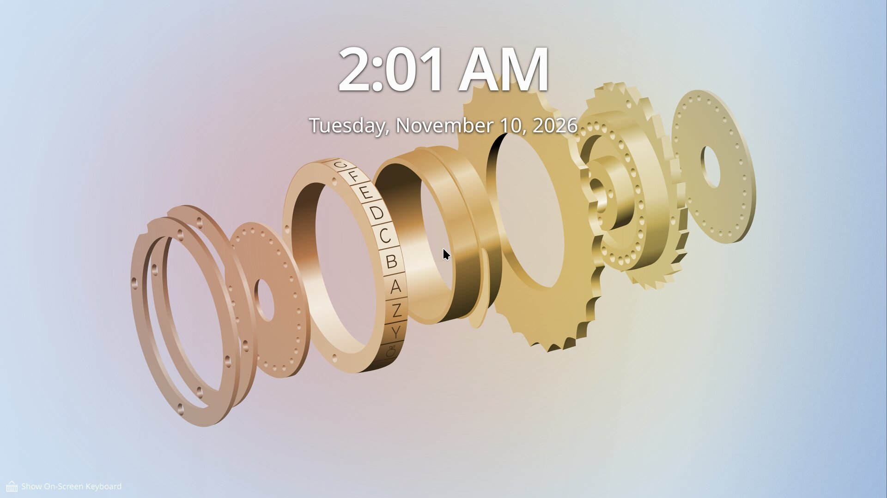 | 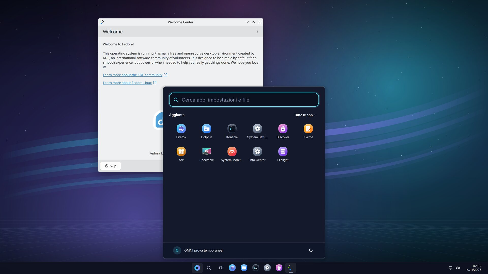 |
| 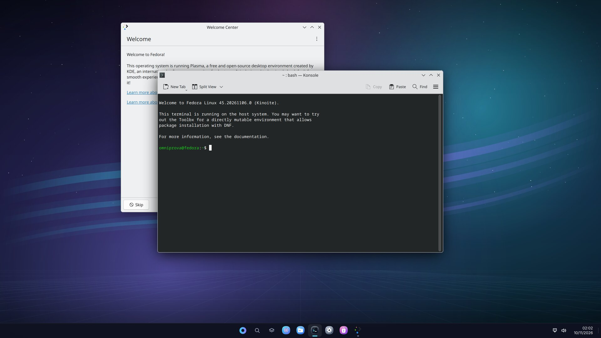 | 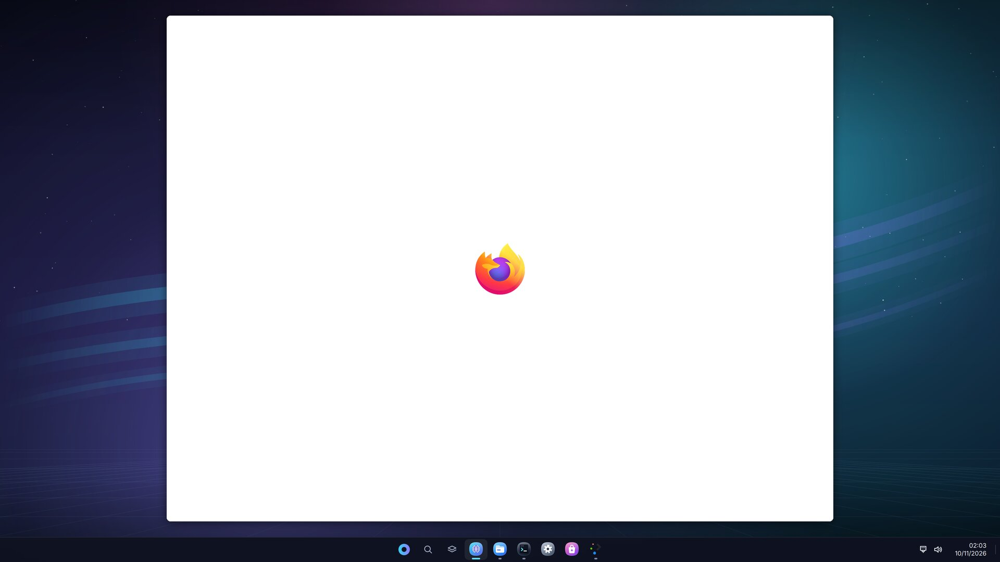 |
| 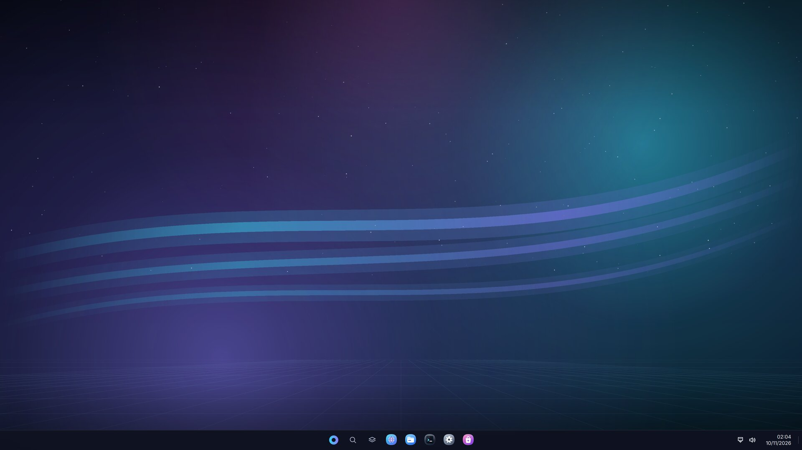 | 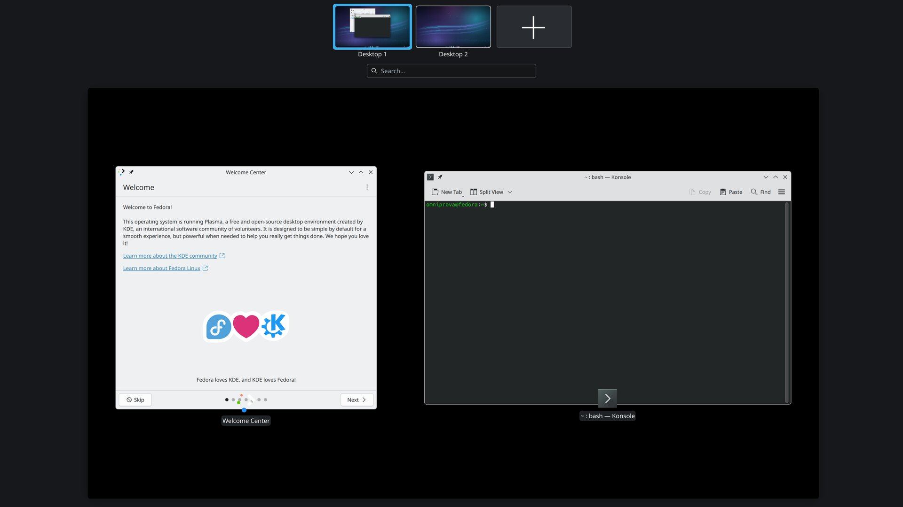 |
| 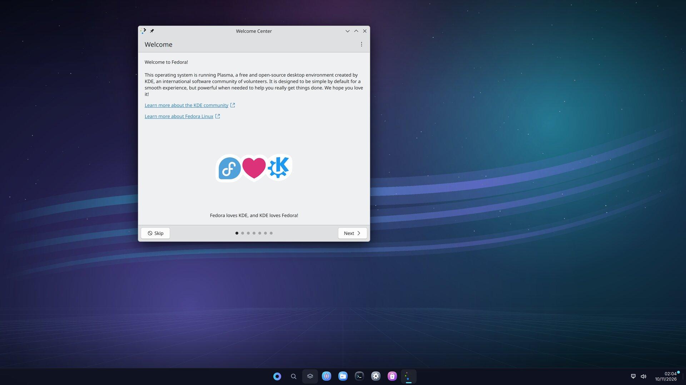 | 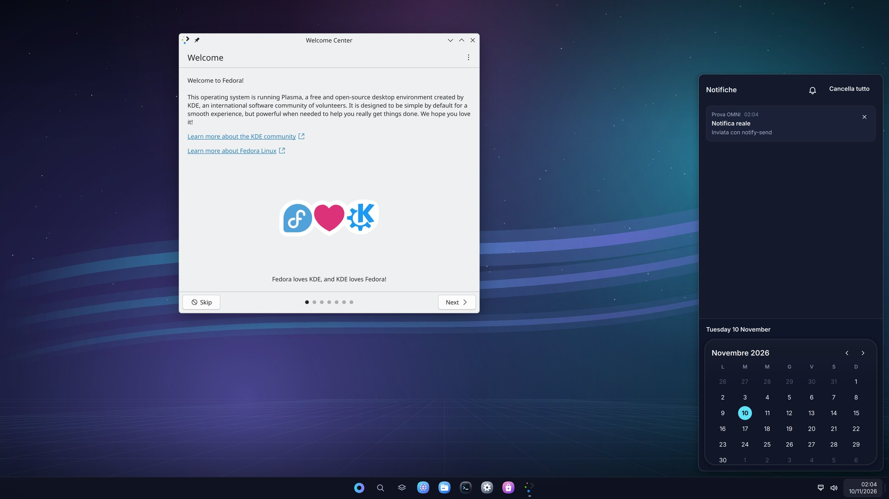 |
| 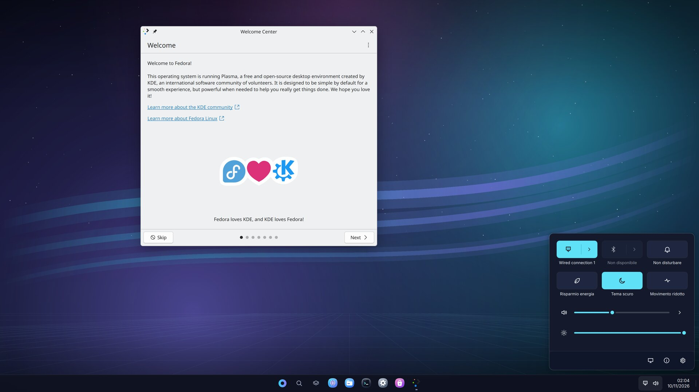 | 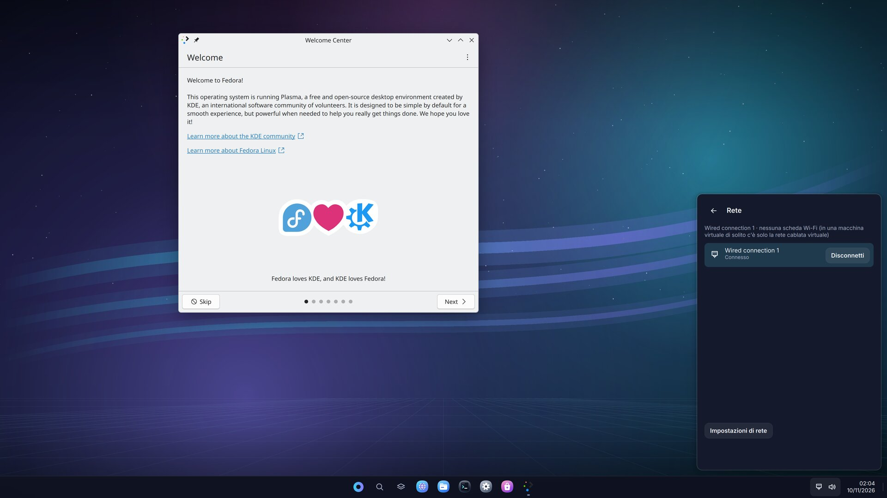 |
|  | 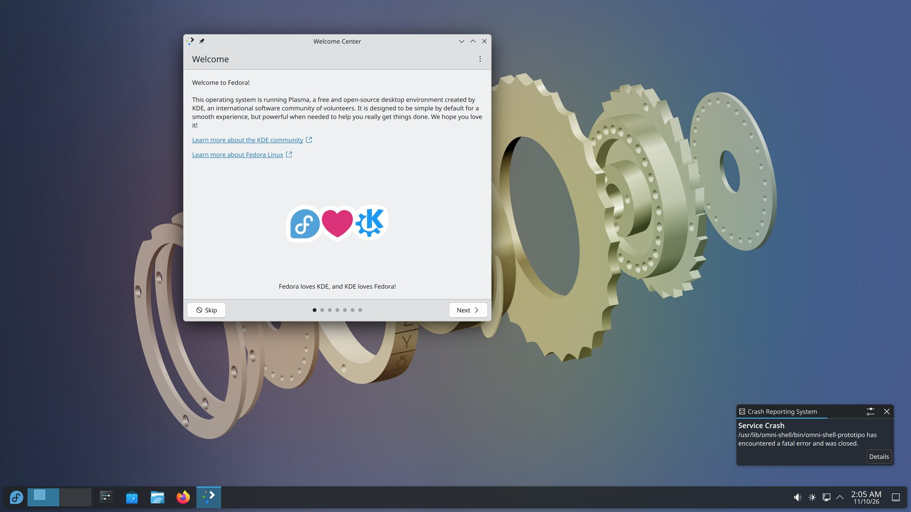 |
| 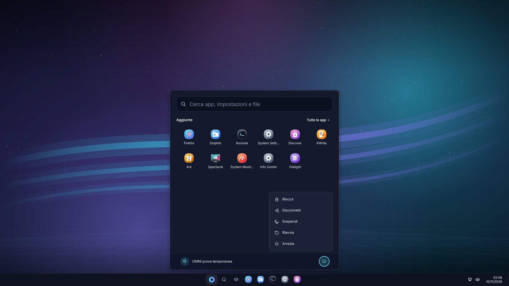 | 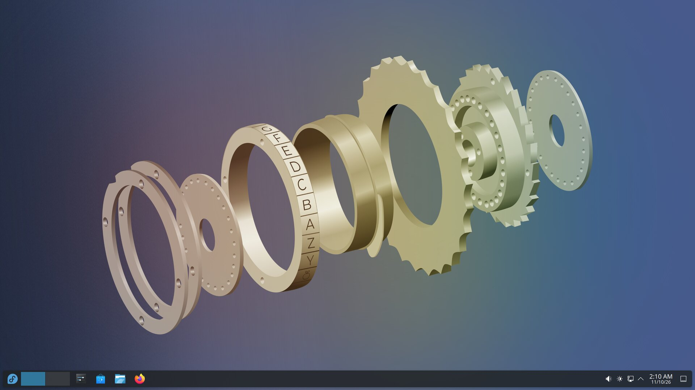 |
