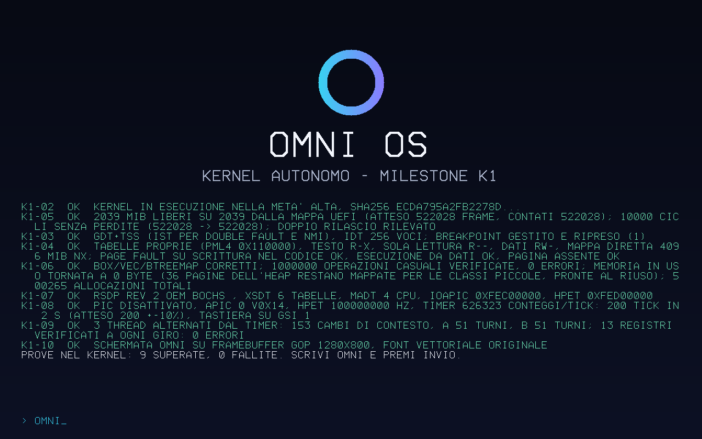
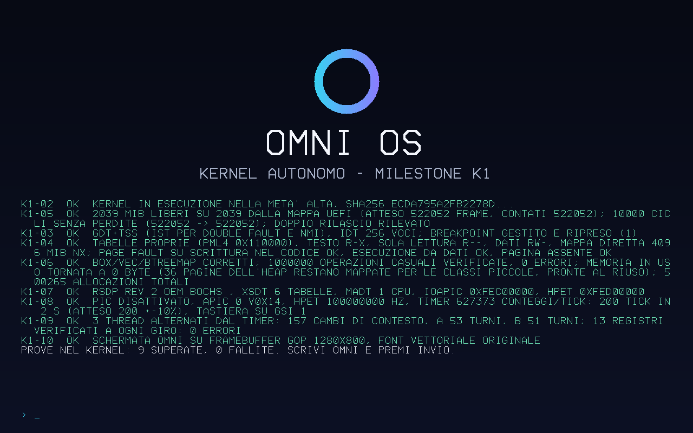

# Risultati della milestone K1

- **Run CI:** `omni-k1` [42812054250](https://github.com/andrew14420100/OMNI-OS/actions/runs/42812054250), commit `fb6cd39`, runner ubuntu-24.04.
- **Esito:** **12 criteri su 12 superati**.
- **Scenari:**
  - QEMU con KVM a 1 e a 4 CPU;
  - QEMU senza KVM (TCG);
  - variante "panico controllato";
  - variante "double fault da overflow dello stack".
- **Prove (artifact `OMNI-K1-prove`, 14 giorni):** rapporto `k1.md`, schermate PNG catturate via QMP, registro seriale completo di ogni avvio.
- **Avvio:** da cartella FAT esposta da QEMU, senza ISO. Nessuna prova sull'hardware del proprietario.

## Schermate (catturate dalla CI)

| QEMU KVM, 4 CPU, dopo la digitazione di "omni" | QEMU TCG, 1 CPU, fine delle prove nel kernel |
|---|---|
|  |  |

## Rapporto generato dalla CI

**Esito complessivo: SUPERATO** (12 criteri su 12 superati, durata 33 s)

| Criterio | Esito | Prova |
|---|---|---|
| K1-01 | OK | [1 CPU, KVM] [omni-boot] firmware: Ubuntu distribution of EDK II (revisione 0x10000); UEFI 2.7 / [omni-boot] mappa di memoria: 125 descrittori, 28 regioni, 2039 MiB liberi / [omni-boot] grafica: 1280x800 passo 1280 formato Bgr a 0x80000000 / [omni-boot] ACPI: RSDP a 0x7fb7e014 · [4 CPU, KVM] [omni-boot] firmware: Ubuntu distribution of EDK II (revisione 0x10000); UEFI 2.7 / [omni-boot] mappa di memoria: 131 descrittori, 28 regioni, 2039 MiB liberi / [omni-boot] grafica: 1280x800 passo 1280 formato Bgr a 0x80000000 / [omni-boot] ACPI: RSDP a 0x7fb7e014 · [1 CPU, TCG] [omni-boot] firmware: Ubuntu distribution of EDK II (revisione 0x10000); UEFI 2.7 / [omni-boot] mappa di memoria: 130 descrittori, 27 regioni, 2039 MiB liberi / [omni-boot] grafica: 1280x800 passo 1280 formato Bgr a 0x80000000 / [omni-boot] ACPI: RSDP a 0x7fb7e014 |
| K1-02 | OK | [1 CPU, KVM] sha256 del file ecda795a2fb2278d = valore stampato da OMNI Boot e dal kernel: sì · [4 CPU, KVM] sha256 del file ecda795a2fb2278d = valore stampato da OMNI Boot e dal kernel: sì · [1 CPU, TCG] sha256 del file ecda795a2fb2278d = valore stampato da OMNI Boot e dal kernel: sì |
| K1-03 | OK | [1 CPU, KVM] OK - GDT+TSS (IST per double fault e NMI), IDT 256 voci; breakpoint gestito e ripreso (1) · [4 CPU, KVM] OK - GDT+TSS (IST per double fault e NMI), IDT 256 voci; breakpoint gestito e ripreso (1) · [1 CPU, TCG] OK - GDT+TSS (IST per double fault e NMI), IDT 256 voci; breakpoint gestito e ripreso (1) · variante prova-doppio-errore: uscita QEMU Some(33); DOUBLE FAULT (stack IST1 dedicato): rip=0xffffffff80001930 rsp=0xfffffe000000adc8 cr2=0xfffffe000000adb8 - pagina di guardia dello stack: overflow dello stack / PROVA K1-03 doppio errore: SUPERATA (rapporto prodotto, nessun riavvio) |
| K1-04 | OK | [1 CPU, KVM] OK - tabelle proprie (PML4 0x110000), testo R-X, sola lettura R--, dati RW-, mappa diretta 4096 MiB NX; page fault su scrittura nel codice ok, esecuzione da dati ok, pagina assente ok · [4 CPU, KVM] OK - tabelle proprie (PML4 0x110000), testo R-X, sola lettura R--, dati RW-, mappa diretta 4096 MiB NX; page fault su scrittura nel codice ok, esecuzione da dati ok, pagina assente ok · [1 CPU, TCG] OK - tabelle proprie (PML4 0x110000), testo R-X, sola lettura R--, dati RW-, mappa diretta 4096 MiB NX; page fault su scrittura nel codice ok, esecuzione da dati ok, pagina assente ok |
| K1-05 | OK | [1 CPU, KVM] OK - 2039 MiB liberi su 2039 dalla mappa UEFI (atteso 522052 frame, contati 522052); 10000 cicli senza perdite (522052 -> 522052); doppio rilascio rilevato · [4 CPU, KVM] OK - 2039 MiB liberi su 2039 dalla mappa UEFI (atteso 522028 frame, contati 522028); 10000 cicli senza perdite (522028 -> 522028); doppio rilascio rilevato · [1 CPU, TCG] OK - 2039 MiB liberi su 2039 dalla mappa UEFI (atteso 522052 frame, contati 522052); 10000 cicli senza perdite (522052 -> 522052); doppio rilascio rilevato |
| K1-06 | OK | [1 CPU, KVM] OK - Box/Vec/BTreeMap corretti; 1000000 operazioni casuali verificate, 0 errori; memoria in uso tornata a 0 byte (36 pagine dell'heap restano mappate per le classi piccole, pronte al riuso); 500265 allocazioni totali · [4 CPU, KVM] OK - Box/Vec/BTreeMap corretti; 1000000 operazioni casuali verificate, 0 errori; memoria in uso tornata a 0 byte (36 pagine dell'heap restano mappate per le classi piccole, pronte al riuso); 500265 allocazioni totali · [1 CPU, TCG] OK - Box/Vec/BTreeMap corretti; 1000000 operazioni casuali verificate, 0 errori; memoria in uso tornata a 0 byte (36 pagine dell'heap restano mappate per le classi piccole, pronte al riuso); 500265 allocazioni totali |
| K1-07 | OK | [1 CPU, KVM] OK - RSDP rev 2 OEM BOCHS , XSDT 6 tabelle, MADT 1 CPU, IOAPIC 0xfec00000, HPET 0xfed00000 · [1 CPU, KVM] CPU trovate nella MADT 1, QEMU -smp 1 · [4 CPU, KVM] OK - RSDP rev 2 OEM BOCHS , XSDT 6 tabelle, MADT 4 CPU, IOAPIC 0xfec00000, HPET 0xfed00000 · [4 CPU, KVM] CPU trovate nella MADT 4, QEMU -smp 4 · [1 CPU, TCG] OK - RSDP rev 2 OEM BOCHS , XSDT 6 tabelle, MADT 1 CPU, IOAPIC 0xfec00000, HPET 0xfed00000 · [1 CPU, TCG] CPU trovate nella MADT 1, QEMU -smp 1 |
| K1-08 | OK | [1 CPU, KVM] OK - PIC disattivato, APIC 0 v0x14, HPET 100000000 Hz, timer 626103 conteggi/tick: 200 tick in 2 s (atteso 200 +-10%), tastiera su GSI 1 · [4 CPU, KVM] OK - PIC disattivato, APIC 0 v0x14, HPET 100000000 Hz, timer 626323 conteggi/tick: 200 tick in 2 s (atteso 200 +-10%), tastiera su GSI 1 · [1 CPU, TCG] OK - PIC disattivato, APIC 0 v0x14, HPET 100000000 Hz, timer 627373 conteggi/tick: 200 tick in 2 s (atteso 200 +-10%), tastiera su GSI 1 |
| K1-09 | OK | [1 CPU, KVM] OK - 3 thread alternati dal timer: 155 cambi di contesto, A 51 turni, B 52 turni; 13 registri verificati a ogni giro: 0 errori · [4 CPU, KVM] OK - 3 thread alternati dal timer: 153 cambi di contesto, A 51 turni, B 51 turni; 13 registri verificati a ogni giro: 0 errori · [1 CPU, TCG] OK - 3 thread alternati dal timer: 157 cambi di contesto, A 53 turni, B 51 turni; 13 registri verificati a ogni giro: 0 errori |
| K1-10 | OK | [1 CPU, KVM] 1280x800; angolo (7, 10, 20) (atteso ~#070a14); anello sinistro (61, 205, 242) (ciano), destro (133, 129, 254) (viola); centro (8, 11, 23) (sfondo); 3058 pixel del titolo; 27824 pixel verdi degli esiti; file principale-1cpu-kvm-schermata.png · [4 CPU, KVM] 1280x800; angolo (7, 10, 20) (atteso ~#070a14); anello sinistro (61, 205, 242) (ciano), destro (133, 129, 254) (viola); centro (8, 11, 23) (sfondo); 3058 pixel del titolo; 27824 pixel verdi degli esiti; file principale-4cpu-kvm-schermata.png · [1 CPU, TCG] 1280x800; angolo (7, 10, 20) (atteso ~#070a14); anello sinistro (61, 205, 242) (ciano), destro (133, 129, 254) (viola); centro (8, 11, 23) (sfondo); 3058 pixel del titolo; 27793 pixel verdi degli esiti; file principale-1cpu-tcg-schermata.png |
| K1-11 | OK | [1 CPU, KVM] tasti o,m,n,i,Invio inviati con QMP send-key: [K1] K1-11 OK - tastiera PS/2 su IOAPIC: ricevuto "omni" (9 interruzioni) · [4 CPU, KVM] tasti o,m,n,i,Invio inviati con QMP send-key: [K1] K1-11 OK - tastiera PS/2 su IOAPIC: ricevuto "omni" (9 interruzioni) · [1 CPU, TCG] tasti o,m,n,i,Invio inviati con QMP send-key: [K1] K1-11 OK - tastiera PS/2 su IOAPIC: ricevuto "omni" (9 interruzioni) |
| K1-12 | OK | variante prova-panico: uscita QEMU Some(33); KERNEL PANIC: prova di panico controllata (K1-12) / KERNEL PANIC: posizione kernel/src/prove.rs:131 / PROVA K1-12 panico: SUPERATA (rapporto su seriale e schermo) |

## Esecuzioni

- [1 CPU, KVM]: tastiera attesa dopo 5.2 s dall'avvio di QEMU; [K1] ESITO: SUPERATO (10 superate, 0 fallite); uscita QEMU Some(33) (attesa 33 = superato)
- [4 CPU, KVM]: tastiera attesa dopo 5.3 s dall'avvio di QEMU; [K1] ESITO: SUPERATO (10 superate, 0 fallite); uscita QEMU Some(33) (attesa 33 = superato)
- [1 CPU, TCG]: tastiera attesa dopo 5.8 s dall'avvio di QEMU; [K1] ESITO: SUPERATO (10 superate, 0 fallite); uscita QEMU Some(33) (attesa 33 = superato)

## Codice e strumenti

- Dipendenze: 4 pacchetti, tutti del workspace OMNI (omni-boot, omni-comune, omni-kernel, omni-xtask); nessun codice di terzi
- Codice: 3863 righe Rust (esclusi commenti e righe vuote); 76 usi di `unsafe`, tutti con il commento `SAFETY` che ne giustifica la correttezza
- `BOOTX64.EFI` (OMNI Boot) sha256 `0ffc0fe5bf8e76210b99e3d2923dd7b1936260d3a77214cb448397325f9420aa`
- `KERNEL.ELF` (variante di prova) sha256 `ecda795a2fb2278df619527b7a665ac0741d16d5964a0265cbb3b04d5c1e7216`
- Strumenti (non inclusi nei binari): rustc 1.97.0 (2d8144b78 2026-07-07); QEMU emulator version 8.2.2 (Debian 1:8.2.2+ds-0ubuntu1.18); firmware OVMF `/usr/share/OVMF/OVMF_CODE_4M.fd`
- Avvio da cartella FAT esposta da QEMU: **nessuna ISO**; macchina q35, 2 GiB, accelerazione KVM e TCG
