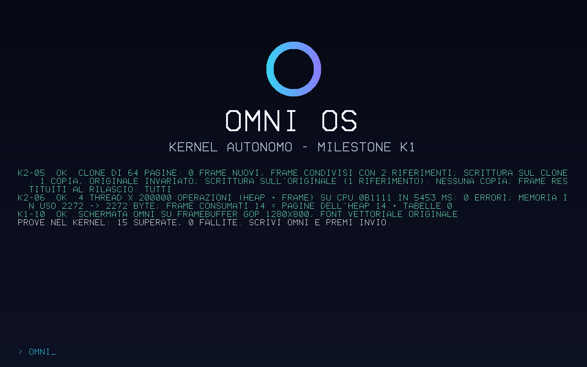

# Risultati della milestone K2

- **Run CI:** `omni-k1` [42817620220](https://github.com/andrew14420100/OMNI-OS/actions/runs/42817620220), commit `10ee9d3`, runner ubuntu-24.04.
- **Esito:** **20 criteri su 20 superati**: K2-01…K2-08 e, come regressione, K1-01…K1-12.
- **Scenari:**
  - QEMU con KVM a 1 e a 4 CPU;
  - QEMU senza KVM (TCG) a 1 e a 4 CPU;
  - varianti di K1 "panico" e "double fault".
- **Ciclo di ogni scenario principale:**
  1. avvio e prove;
  2. tastiera;
  3. **riavvio ACPI vero** (firmware, OMNI Boot e kernel ripartono);
  4. secondo avvio con tutte le prove ripetute;
  5. **spegnimento ACPI**: QEMU termina da solo con codice 0.
- **Prove (artifact `OMNI-prove-K2`, 14 giorni):** rapporto, schermate PNG, registro seriale completo di entrambi gli avvii.
- **Avvio:** da cartella FAT esposta da QEMU, senza ISO. Nessuna prova sull'hardware del proprietario.

## Difetto trovato dalle prove e corretto

La prova di stress K2-06 ha mostrato che i blocchi grandi dell'heap non riusavano lo spazio
virtuale liberato. Per questo servivano sempre nuove tabelle di pagine: 163 in una sola prova.
Dopo 1 GiB di allocazioni grandi l'heap si sarebbe esaurito.

Ora gli intervalli liberati vengono riusati: nella stessa prova servono **0 tabelle in più**.

## Rapporto generato dalla CI

**Esito complessivo: SUPERATO** (20 criteri su 20 superati, durata 142 s)

| Criterio | Esito | Prova |
|---|---|---|
| K1-01 | OK | [1 CPU, KVM] [omni-boot] firmware: Ubuntu distribution of EDK II (revisione 0x10000); UEFI 2.7 / [omni-boot] mappa di memoria: 125 descrittori, 28 regioni, 2038 MiB liberi / [omni-boot] grafica: 1280x800 passo 1280 formato Bgr a 0x80000000 / [omni-boot] ACPI: RSDP a 0x7fb7e014 · [4 CPU, KVM] [omni-boot] firmware: Ubuntu distribution of EDK II (revisione 0x10000); UEFI 2.7 / [omni-boot] mappa di memoria: 131 descrittori, 28 regioni, 2038 MiB liberi / [omni-boot] grafica: 1280x800 passo 1280 formato Bgr a 0x80000000 / [omni-boot] ACPI: RSDP a 0x7fb7e014 · [1 CPU, TCG] [omni-boot] firmware: Ubuntu distribution of EDK II (revisione 0x10000); UEFI 2.7 / [omni-boot] mappa di memoria: 130 descrittori, 27 regioni, 2038 MiB liberi / [omni-boot] grafica: 1280x800 passo 1280 formato Bgr a 0x80000000 / [omni-boot] ACPI: RSDP a 0x7fb7e014 · [4 CPU, TCG] [omni-boot] firmware: Ubuntu distribution of EDK II (revisione 0x10000); UEFI 2.7 / [omni-boot] mappa di memoria: 128 descrittori, 29 regioni, 2038 MiB liberi / [omni-boot] grafica: 1280x800 passo 1280 formato Bgr a 0x80000000 / [omni-boot] ACPI: RSDP a 0x7fb7e014 |
| K1-02 | OK | [1 CPU, KVM] sha256 del file 8f5ee7a7bd558187 = valore stampato da OMNI Boot e dal kernel: sì · [4 CPU, KVM] sha256 del file 8f5ee7a7bd558187 = valore stampato da OMNI Boot e dal kernel: sì · [1 CPU, TCG] sha256 del file 8f5ee7a7bd558187 = valore stampato da OMNI Boot e dal kernel: sì · [4 CPU, TCG] sha256 del file 8f5ee7a7bd558187 = valore stampato da OMNI Boot e dal kernel: sì |
| K1-03 | OK | [1 CPU, KVM] OK - GDT+TSS (IST per double fault e NMI), IDT 256 voci; breakpoint gestito e ripreso (1) · [4 CPU, KVM] OK - GDT+TSS (IST per double fault e NMI), IDT 256 voci; breakpoint gestito e ripreso (1) · [1 CPU, TCG] OK - GDT+TSS (IST per double fault e NMI), IDT 256 voci; breakpoint gestito e ripreso (1) · [4 CPU, TCG] OK - GDT+TSS (IST per double fault e NMI), IDT 256 voci; breakpoint gestito e ripreso (1) · variante prova-doppio-errore: uscita QEMU Some(33); DOUBLE FAULT (stack IST1 dedicato): rip=0xffffffff800059d0 rsp=0xfffffe000000add8 cr2=0xfffffe000000adc8 - pagina di guardia dello stack: overflow dello stack / PROVA K1-03 doppio errore: SUPERATA (rapporto prodotto, nessun riavvio) |
| K1-04 | OK | [1 CPU, KVM] OK - tabelle proprie (PML4 0x110000), testo R-X, sola lettura R--, dati RW-, mappa diretta 4096 MiB NX; page fault su scrittura nel codice ok, esecuzione da dati ok, pagina assente ok · [4 CPU, KVM] OK - tabelle proprie (PML4 0x110000), testo R-X, sola lettura R--, dati RW-, mappa diretta 4096 MiB NX; page fault su scrittura nel codice ok, esecuzione da dati ok, pagina assente ok · [1 CPU, TCG] OK - tabelle proprie (PML4 0x110000), testo R-X, sola lettura R--, dati RW-, mappa diretta 4096 MiB NX; page fault su scrittura nel codice ok, esecuzione da dati ok, pagina assente ok · [4 CPU, TCG] OK - tabelle proprie (PML4 0x110000), testo R-X, sola lettura R--, dati RW-, mappa diretta 4096 MiB NX; page fault su scrittura nel codice ok, esecuzione da dati ok, pagina assente ok |
| K1-05 | OK | [1 CPU, KVM] OK - 2037 MiB liberi su 2038 dalla mappa UEFI (atteso 521712 frame, contati 521712); 10000 cicli senza perdite (521712 -> 521712); doppio rilascio rilevato · [4 CPU, KVM] OK - 2037 MiB liberi su 2038 dalla mappa UEFI (atteso 521688 frame, contati 521688); 10000 cicli senza perdite (521688 -> 521688); doppio rilascio rilevato · [1 CPU, TCG] OK - 2037 MiB liberi su 2038 dalla mappa UEFI (atteso 521712 frame, contati 521712); 10000 cicli senza perdite (521712 -> 521712); doppio rilascio rilevato · [4 CPU, TCG] OK - 2037 MiB liberi su 2038 dalla mappa UEFI (atteso 521688 frame, contati 521688); 10000 cicli senza perdite (521688 -> 521688); doppio rilascio rilevato |
| K1-06 | OK | [1 CPU, KVM] OK - Box/Vec/BTreeMap corretti; 1000000 operazioni casuali verificate, 0 errori; memoria in uso tornata a 0 byte (36 pagine dell'heap restano mappate per le classi piccole, pronte al riuso); 500265 allocazioni totali · [4 CPU, KVM] OK - Box/Vec/BTreeMap corretti; 1000000 operazioni casuali verificate, 0 errori; memoria in uso tornata a 0 byte (36 pagine dell'heap restano mappate per le classi piccole, pronte al riuso); 500265 allocazioni totali · [1 CPU, TCG] OK - Box/Vec/BTreeMap corretti; 1000000 operazioni casuali verificate, 0 errori; memoria in uso tornata a 0 byte (36 pagine dell'heap restano mappate per le classi piccole, pronte al riuso); 500265 allocazioni totali · [4 CPU, TCG] OK - Box/Vec/BTreeMap corretti; 1000000 operazioni casuali verificate, 0 errori; memoria in uso tornata a 0 byte (36 pagine dell'heap restano mappate per le classi piccole, pronte al riuso); 500265 allocazioni totali |
| K1-07 | OK | [1 CPU, KVM] OK - RSDP rev 2 OEM BOCHS , XSDT 6 tabelle, MADT 1 CPU, IOAPIC 0xfec00000, HPET 0xfed00000 · [1 CPU, KVM] CPU trovate nella MADT 1, QEMU -smp 1 · [4 CPU, KVM] OK - RSDP rev 2 OEM BOCHS , XSDT 6 tabelle, MADT 4 CPU, IOAPIC 0xfec00000, HPET 0xfed00000 · [4 CPU, KVM] CPU trovate nella MADT 4, QEMU -smp 4 · [1 CPU, TCG] OK - RSDP rev 2 OEM BOCHS , XSDT 6 tabelle, MADT 1 CPU, IOAPIC 0xfec00000, HPET 0xfed00000 · [1 CPU, TCG] CPU trovate nella MADT 1, QEMU -smp 1 · [4 CPU, TCG] OK - RSDP rev 2 OEM BOCHS , XSDT 6 tabelle, MADT 4 CPU, IOAPIC 0xfec00000, HPET 0xfed00000 · [4 CPU, TCG] CPU trovate nella MADT 4, QEMU -smp 4 |
| K1-08 | OK | [1 CPU, KVM] OK - PIC disattivato, APIC 0 v0x14, HPET 100000000 Hz, timer 626288 conteggi/tick: 200 tick in 2 s (atteso 200 +-10%), tastiera su GSI 1 · [4 CPU, KVM] OK - PIC disattivato, APIC 0 v0x14, HPET 100000000 Hz, timer 626695 conteggi/tick: 200 tick in 2 s (atteso 200 +-10%), tastiera su GSI 1 · [1 CPU, TCG] OK - PIC disattivato, APIC 0 v0x14, HPET 100000000 Hz, timer 627948 conteggi/tick: 200 tick in 2 s (atteso 200 +-10%), tastiera su GSI 1 · [4 CPU, TCG] OK - PIC disattivato, APIC 0 v0x14, HPET 100000000 Hz, timer 631077 conteggi/tick: 199 tick in 2 s (atteso 200 +-10%), tastiera su GSI 1 |
| K1-09 | OK | [1 CPU, KVM] OK - 3 thread alternati dal timer: 155 cambi di contesto, A 51 turni, B 52 turni; 13 registri verificati a ogni giro: 0 errori · [4 CPU, KVM] OK - 3 thread alternati dal timer: 153 cambi di contesto, A 51 turni, B 51 turni; 13 registri verificati a ogni giro: 0 errori · [1 CPU, TCG] OK - 3 thread alternati dal timer: 153 cambi di contesto, A 51 turni, B 51 turni; 13 registri verificati a ogni giro: 0 errori · [4 CPU, TCG] OK - 3 thread alternati dal timer: 177 cambi di contesto, A 59 turni, B 59 turni; 13 registri verificati a ogni giro: 0 errori |
| K1-10 | OK | [1 CPU, KVM] 1280x800; angolo (7, 10, 20) (atteso ~#070a14); anello sinistro (61, 205, 242) (ciano), destro (133, 129, 254) (viola); centro (8, 11, 23) (sfondo); 3058 pixel del titolo; 8812 pixel verdi degli esiti; file principale-1cpu-kvm-schermata.png · [4 CPU, KVM] 1280x800; angolo (7, 10, 20) (atteso ~#070a14); anello sinistro (61, 205, 242) (ciano), destro (133, 129, 254) (viola); centro (8, 11, 23) (sfondo); 3058 pixel del titolo; 11228 pixel verdi degli esiti; file principale-4cpu-kvm-schermata.png · [1 CPU, TCG] 1280x800; angolo (7, 10, 20) (atteso ~#070a14); anello sinistro (61, 205, 242) (ciano), destro (133, 129, 254) (viola); centro (8, 11, 23) (sfondo); 3058 pixel del titolo; 8871 pixel verdi degli esiti; file principale-1cpu-tcg-schermata.png · [4 CPU, TCG] 1280x800; angolo (7, 10, 20) (atteso ~#070a14); anello sinistro (61, 205, 242) (ciano), destro (133, 129, 254) (viola); centro (8, 11, 23) (sfondo); 3058 pixel del titolo; 11229 pixel verdi degli esiti; file principale-4cpu-tcg-schermata.png |
| K1-11 | OK | [1 CPU, KVM] tasti o,m,n,i,Invio inviati con QMP send-key: [PROVA] K1-11 OK - tastiera PS/2 su IOAPIC: ricevuto "omni" (9 interruzioni) · [4 CPU, KVM] tasti o,m,n,i,Invio inviati con QMP send-key: [PROVA] K1-11 OK - tastiera PS/2 su IOAPIC: ricevuto "omni" (9 interruzioni) · [1 CPU, TCG] tasti o,m,n,i,Invio inviati con QMP send-key: [PROVA] K1-11 OK - tastiera PS/2 su IOAPIC: ricevuto "omni" (9 interruzioni) · [4 CPU, TCG] tasti o,m,n,i,Invio inviati con QMP send-key: [PROVA] K1-11 OK - tastiera PS/2 su IOAPIC: ricevuto "omni" (9 interruzioni) |
| K1-12 | OK | variante prova-panico: uscita QEMU Some(33); KERNEL PANIC: prova di panico controllata (K1-12) / KERNEL PANIC: posizione kernel/src/prove.rs:137 / PROVA K1-12 panico: SUPERATA (rapporto su seriale e schermo) |
| K2-01 | OK | [1 CPU, KVM] OK - 1 CPU su 1 della MADT in linea in 0 ms (INIT-SIPI-SIPI, trampolino reale->lungo); GDT/TSS/IST e timer APIC per CPU · [1 CPU, KVM] CPU in linea 1, QEMU -smp 1 · [4 CPU, KVM] OK - 4 CPU su 4 della MADT in linea in 34 ms (INIT-SIPI-SIPI, trampolino reale->lungo); GDT/TSS/IST e timer APIC per CPU · [4 CPU, KVM] CPU in linea 4, QEMU -smp 4 · [1 CPU, TCG] OK - 1 CPU su 1 della MADT in linea in 0 ms (INIT-SIPI-SIPI, trampolino reale->lungo); GDT/TSS/IST e timer APIC per CPU · [1 CPU, TCG] CPU in linea 1, QEMU -smp 1 · [4 CPU, TCG] OK - 4 CPU su 4 della MADT in linea in 33 ms (INIT-SIPI-SIPI, trampolino reale->lungo); GDT/TSS/IST e timer APIC per CPU · [4 CPU, TCG] CPU in linea 4, QEMU -smp 4 |
| K2-02 | OK | [1 CPU, KVM] OK - 8 thread su 1 CPU: 800000 incrementi sotto blocco (attesi 800000), CPU usate 0b1 su 0b1 · [4 CPU, KVM] OK - 8 thread su 4 CPU: 800000 incrementi sotto blocco (attesi 800000), CPU usate 0b1111 su 0b1111 · [1 CPU, TCG] OK - 8 thread su 1 CPU: 800000 incrementi sotto blocco (attesi 800000), CPU usate 0b1 su 0b1 · [4 CPU, TCG] OK - 8 thread su 4 CPU: 800000 incrementi sotto blocco (attesi 800000), CPU usate 0b1111 su 0b1111 |
| K2-03 | OK | [1 CPU, KVM] OK - pagina letta da 1 CPU, rimossa con 0 shootdown via IPI: page fault sulla rilettura in 1 CPU su 1 (nessuna traduzione vecchia) · [4 CPU, KVM] OK - pagina letta da 4 CPU, rimossa con 1 shootdown via IPI: page fault sulla rilettura in 4 CPU su 4 (nessuna traduzione vecchia) · [1 CPU, TCG] OK - pagina letta da 1 CPU, rimossa con 0 shootdown via IPI: page fault sulla rilettura in 1 CPU su 1 (nessuna traduzione vecchia) · [4 CPU, TCG] OK - pagina letta da 4 CPU, rimossa con 1 shootdown via IPI: page fault sulla rilettura in 4 CPU su 4 (nessuna traduzione vecchia) |
| K2-04 | OK | [1 CPU, KVM] OK - regione da 64 MiB senza frame; 1000 pagine toccate: 1000 page fault, 1000 pagine presenti, 1000 frame (+28 tabelle); contenuto verificato; dopo il rilascio frame liberi 521611 (prima 521611) · [4 CPU, KVM] OK - regione da 64 MiB senza frame; 1000 pagine toccate: 1000 page fault, 1000 pagine presenti, 1000 frame (+28 tabelle); contenuto verificato; dopo il rilascio frame liberi 521548 (prima 521548) · [1 CPU, TCG] OK - regione da 64 MiB senza frame; 1000 pagine toccate: 1000 page fault, 1000 pagine presenti, 1000 frame (+28 tabelle); contenuto verificato; dopo il rilascio frame liberi 521611 (prima 521611) · [4 CPU, TCG] OK - regione da 64 MiB senza frame; 1000 pagine toccate: 1000 page fault, 1000 pagine presenti, 1000 frame (+28 tabelle); contenuto verificato; dopo il rilascio frame liberi 521548 (prima 521548) |
| K2-05 | OK | [1 CPU, KVM] OK - clone di 64 pagine: 0 frame nuovi, frame condivisi con 2 riferimenti; scrittura sul clone: 1 copia, originale invariato; scrittura sull'originale (1 riferimento): nessuna copia; frame restituiti al rilascio: tutti · [4 CPU, KVM] OK - clone di 64 pagine: 0 frame nuovi, frame condivisi con 2 riferimenti; scrittura sul clone: 1 copia, originale invariato; scrittura sull'originale (1 riferimento): nessuna copia; frame restituiti al rilascio: tutti · [1 CPU, TCG] OK - clone di 64 pagine: 0 frame nuovi, frame condivisi con 2 riferimenti; scrittura sul clone: 1 copia, originale invariato; scrittura sull'originale (1 riferimento): nessuna copia; frame restituiti al rilascio: tutti · [4 CPU, TCG] OK - clone di 64 pagine: 0 frame nuovi, frame condivisi con 2 riferimenti; scrittura sul clone: 1 copia, originale invariato; scrittura sull'originale (1 riferimento): nessuna copia; frame restituiti al rilascio: tutti |
| K2-06 | OK | [1 CPU, KVM] OK - 4 thread x 200000 operazioni (heap + frame) su CPU 0b1 in 417 ms: 0 errori; memoria in uso 1696 -> 1696 byte; frame consumati 12 = pagine dell'heap 12 + tabelle 0 · [4 CPU, KVM] OK - 4 thread x 200000 operazioni (heap + frame) su CPU 0b1111 in 5453 ms: 0 errori; memoria in uso 2272 -> 2272 byte; frame consumati 14 = pagine dell'heap 14 + tabelle 0 · [1 CPU, TCG] OK - 4 thread x 200000 operazioni (heap + frame) su CPU 0b1 in 3105 ms: 0 errori; memoria in uso 1696 -> 1696 byte; frame consumati 13 = pagine dell'heap 13 + tabelle 0 · [4 CPU, TCG] OK - 4 thread x 200000 operazioni (heap + frame) su CPU 0b1111 in 5393 ms: 0 errori; memoria in uso 2272 -> 2272 byte; frame consumati 14 = pagine dell'heap 14 + tabelle 0 |
| K2-07 | OK | [1 CPU, KVM] [K2] spegnimento ACPI (SLP_TYP da \_S5 Some((0, 0)), PM1a_CNT 0x604); uscita di QEMU Some(0) (attesa 0: macchina spenta dal kernel) · [4 CPU, KVM] [K2] spegnimento ACPI (SLP_TYP da \_S5 Some((0, 0)), PM1a_CNT 0x604); uscita di QEMU Some(0) (attesa 0: macchina spenta dal kernel) · [1 CPU, TCG] [K2] spegnimento ACPI (SLP_TYP da \_S5 Some((0, 0)), PM1a_CNT 0x604); uscita di QEMU Some(0) (attesa 0: macchina spenta dal kernel) · [4 CPU, TCG] [K2] spegnimento ACPI (SLP_TYP da \_S5 Some((0, 0)), PM1a_CNT 0x604); uscita di QEMU Some(0) (attesa 0: macchina spenta dal kernel) |
| K2-08 | OK | [1 CPU, KVM] [K2] riavvio ACPI richiesto (registro di reset Some((1, 3321, 15))); avvii di OMNI Boot nel registro: 2; [PROVA] K2-08 OK - riavvio completato: firmware, OMNI Boot e kernel ripartiti e riavvio riconosciuto · [4 CPU, KVM] [K2] riavvio ACPI richiesto (registro di reset Some((1, 3321, 15))); avvii di OMNI Boot nel registro: 2; [PROVA] K2-08 OK - riavvio completato: firmware, OMNI Boot e kernel ripartiti e riavvio riconosciuto · [1 CPU, TCG] [K2] riavvio ACPI richiesto (registro di reset Some((1, 3321, 15))); avvii di OMNI Boot nel registro: 2; [PROVA] K2-08 OK - riavvio completato: firmware, OMNI Boot e kernel ripartiti e riavvio riconosciuto · [4 CPU, TCG] [K2] riavvio ACPI richiesto (registro di reset Some((1, 3321, 15))); avvii di OMNI Boot nel registro: 2; [PROVA] K2-08 OK - riavvio completato: firmware, OMNI Boot e kernel ripartiti e riavvio riconosciuto |

## Esecuzioni

- [1 CPU, KVM]: tastiera attesa dopo 7.5 s dall'avvio di QEMU; esiti dei due avvii: [K2] ESITO: SUPERATO (16 superate, 0 fallite) / [K2] ESITO: SUPERATO (16 superate, 0 fallite); uscita QEMU Some(0) (attesa 0 = spegnimento ACPI)
- [4 CPU, KVM]: tastiera attesa dopo 11.9 s dall'avvio di QEMU; esiti dei due avvii: [K2] ESITO: SUPERATO (16 superate, 0 fallite) / [K2] ESITO: SUPERATO (16 superate, 0 fallite); uscita QEMU Some(0) (attesa 0 = spegnimento ACPI)
- [1 CPU, TCG]: tastiera attesa dopo 18.4 s dall'avvio di QEMU; esiti dei due avvii: [K2] ESITO: SUPERATO (16 superate, 0 fallite) / [K2] ESITO: SUPERATO (16 superate, 0 fallite); uscita QEMU Some(0) (attesa 0 = spegnimento ACPI)
- [4 CPU, TCG]: tastiera attesa dopo 23.7 s dall'avvio di QEMU; esiti dei due avvii: [K2] ESITO: SUPERATO (16 superate, 0 fallite) / [K2] ESITO: SUPERATO (16 superate, 0 fallite); uscita QEMU Some(0) (attesa 0 = spegnimento ACPI)

## Codice e strumenti

- Dipendenze: 4 pacchetti, tutti del workspace OMNI (omni-boot, omni-comune, omni-kernel, omni-xtask); nessun codice di terzi
- Codice: 4855 righe Rust (esclusi commenti e righe vuote); 95 usi di `unsafe`, tutti con il commento `SAFETY` che ne giustifica la correttezza
- `BOOTX64.EFI` (OMNI Boot) sha256 `f13d75a1f93414eaf0164f70757956807a8e02b4998a712725d23e454701cbe3`
- `KERNEL.ELF` (variante di prova) sha256 `8f5ee7a7bd558187f1f377d9c82c6588db912486c6032e8d483d1ffd4a1ae4de`
- Strumenti (non inclusi nei binari): rustc 1.97.0 (2d8144b78 2026-07-07); QEMU emulator version 8.2.2 (Debian 1:8.2.2+ds-0ubuntu1.18); firmware OVMF `/usr/share/OVMF/OVMF_CODE_4M.fd`
- Avvio da cartella FAT esposta da QEMU: **nessuna ISO**; macchina q35, 2 GiB, accelerazione KVM e TCG
